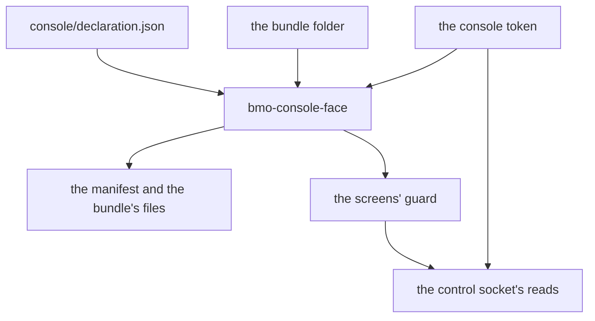

# The boundary

**Fixed API, version 0.1.0-rev.9.** This document is the tool host's fixed API: every contract it exposes to another
unit, grouped by the resource each acts on. It is fixed before any caller is connected to it, and every caller is
served the same routes in the same shapes. Another unit reaches the host only across it: never by its code, its
tables, its files or its process. The host calls no other unit; a console reaches it on the console face alone
(「The console face」), and `bmo-pocket put` declares a tool's app on the account service's delegation chain (「The
CLI」, 「An app on the delegation chain」). How the host behaves behind these contracts is
`docs/mcp-host.md` and `docs/toolbook.md`; how tools are installed is `docs/registry.md`.

## Version

- **The repository has one version,** numbered as bmo-chat's `docs/conventions.md` states in 「Versions」: before
  the first release it is `0.1.0` and counts revisions, `0.1.0-rev.<n>`, and major, minor and patch do not move.
- **Every crate and package the repository publishes carries it,** and so do `GET /health`, the OpenAPI document's
  `info.version` and the harness plugin: `bmo-tool`, `mcp-host`, `bmo-pocket-client`, `bmo-pocket-plugin`,
  `@bmo/pocket-client`, the console bundle `bmo-pocket-console` and the TypeScript and Python tool kits.
- **The call protocol has a version of its own, 1,** which every manifest and every handed object names; a
  manifest speaking another is left out rather than misread.

## The wire format

- **The common wire format of bmo,** as bmo-chat's `docs/conventions.md` states it: keys in camelCase, times as
  one integer of epoch milliseconds, error codes in kebab-case, and a list paged by one cursor and `limit` into
  `{"items": [...], "more": boolean}`. This document states only what the host serves in it.
- **Every failure and every refusal is a non-2xx status** with a JSON body of two keys: `code`, a stable code a
  caller decides on, and `error`, an English sentence saying why. No 2xx answer stands for a refusal of the host's.
- **A tool's own answer is not the host's refusal.** A call the host made and the tool answered is 200 with the
  tool's result as the tool wrote it, `isError` among it where the tool says it failed.

### Error codes

| Status | Code | Answered where |
|---|---|---|
| 400 | `bad-request` | a body or a query that does not read as the route takes it: a session record, a call, a claim, a cursor or a `limit` that is not a positive integer; the sentence names what is wrong |
| 401 | `unauthorized` | a request carries no bearer token, or one naming neither the issuer token nor a tool session: never issued, revoked, or past its `expiresAt`; on the console face, one that is not the console token |
| 403 | `forbidden` | the token is right but may not do this: a tool-session token on an issuer's route, a call whose entry declares a grant the session's grants do not hold, the sentence naming the missing grant, or a call of an entry whose app the session's record withholds, the sentence saying it is turned off by the organisation's settings; on the console face, a route the screen uses asked with no `Owner-Role` allowing the screen's role |
| 404 | `not-found` | the route is right, but the namespace, the entry or the tool session its path or body names is not one the token sees; on the console face, the manifest, the words or a bundle file where the host holds no bundle or no file of that name |
| 404 | `no-route` | no route answers the method and path |
| 410 | `gone` | `GET /events`, where an event after the cursor is no longer held: one older than the window the host holds, or a cursor of an earlier run of the host (「Events」) |
| 422 | `arguments-misfit` | `POST /tool-calls`, where the input does not fit the entry's schema in the form the session holds; the sentence names each misfit and carries the schema |
| 500 | `failed` | the host failed, as where a record could not be kept or taken back on disk; the sentence is the failure |
| 502 | `runner-unreached` | `GET /screens/{tool}/{digest}/{path}`, where the runner the session's record names cannot be reached, does not answer the file, or answers bytes that are not the ones the screen's index names; the sentence says which (「Personal screens」) |
| 502 | `tool-failed` | `POST /tool-calls`, where the tool exited uncleanly, answered what is not a tool result, or its external server could not be reached or failed the call; or where the record it ran under was revoked or lapsed mid-call, the sentence saying it was cancelled because its caller is gone (`docs/mcp-host.md`, 「The host's stop」) |

## The OpenAPI document and the clients

- **`docs/openapi.json` states every route of the control socket** in OpenAPI 3.1: each route's method, path,
  query, request body, answer and the error codes it can give, every JSON body as a JSON Schema, one `bearer`
  security scheme on every route, and the server `/`. The event stream is stated as its two answers: the page of
  events as JSON, and `text/event-stream` with the schema of one event's data under `x-event`. Under `x-tools` it
  states the harness plugin's four fixed tools, each with its input and output schemas and the route it calls,
  and under `x-harness` the plugin, the command that starts it and what a harness does first with it. It is generated by the Rust client from the types
  it sends and reads, which are the types the host answers with, and never edited by hand:
  `cargo run -p bmo-pocket-client --example openapi > docs/openapi.json` writes it again, and the client's tests
  fail where the committed file differs from what it generates. This document is the canonical statement: where the
  two disagree, the code is repaired and the file generated again.
- **The Rust client, the crate `bmo-pocket-client` in `client/`,** holds the wire types and one call per route over
  the control socket, each with a bearer token. A failure reads as the route's error answer, its `code` and `error`
  with it, or as the socket not being reached at all, which a caller waiting on a restarting host tells apart.
- **The TypeScript client, the package `@bmo/pocket-client` in `client/`,** is generated from the same document:
  its types by `openapi-typescript` into `generated/openapi.d.ts`, which its tests generate afresh and compare, and
  its calls by `openapi-fetch` over Bun's `fetch` on the control socket. `bun run generate` in `client/` writes the
  types again.
- **A client carries this contract and nothing else.** A caller uses one of them and writes none of its own.

## The harness plugin

- **`bmo-pocket mcp` starts the host's MCP server for a harness,** on standard input and output, with a tool
  session's token (`--token`, or `BMO_POCKET_TOKEN`) and the control socket (`--socket`, or `BMO_MCP_HOST_SOCKET`,
  or the default path). It is the crate `bmo-pocket-plugin` in `plugin/`, and every tool it serves is a thin call
  of one route through `bmo-pocket-client`.
- **It serves four fixed tools,** with the input and output schemas `x-tools` states:

| Tool | Input | Route it calls |
|---|---|---|
| `pocket_namespaces` | `after?`, `limit?` | `GET /namespaces` |
| `pocket_tools` | `namespace`, `after?`, `limit?` | `GET /namespaces/{namespace}/tools` |
| `pocket_tool` | `namespace`, `toolName` | `GET /namespaces/{namespace}/tools/{toolName}` |
| `pocket_call` | `namespace`, `name`, `input` | `POST /tool-calls` |

- **Beside them, every hosted tool of the session's namespaces,** named `<namespace>_<name>`, with its title,
  description, input and output schemas and its hints as the tool's member states them. Its `tools/list` reads the
  session's namespaces and their tools afresh, page by page; a call of a hosted tool is one `POST /tool-calls`, and
  its answer is the tool's result. Where two hosted tools would take one name, or one would take a fixed tool's,
  neither is listed under it, and each is reached through `pocket_call`.
- **A refusal reaches the harness as a tool result** with `isError` true, whose text is the route's `error` and
  `code`, since the protocol's caller is a model.
- **The `bmo-pocket` skill,** in `plugin/skills/bmo-pocket/`, tells a harness when and how to use the plugin.

## The tools face: MCP over HTTP

- **On the loopback address only,** at the port `--port` or `BMO_MCP_HOST_PORT` names, 3290 where neither does.
- **`/mcp/<namespace>`** for every namespace a placed manifest declares, and **`/mcp/toolbook`** for the toolbook;
  each is a streamable HTTP MCP server with no protocol session kept: every request stands alone, each answer one
  JSON body. **`/use`** is the face's own plain JSON routes for a session's asynchronous calls (「Asynchronous
  calls」). The OpenAPI document does not state this face: it is MCP's own protocol.
- **Every request carries `Authorization: Bearer <token>`,** a tool session's token. A request without one, or with
  one naming no session, is answered 401 `unauthorized`; a namespace no placed manifest declares, or one the
  session's `namespaces` does not name, 404 `not-found`. Each in the common error shape.
- **What a namespace serves:** `tools/list` lists the entries the session holds in it that its `shown` names, each
  with its name, title, description, input schema, output schema where it declares one, and its annotations
  (`readOnlyHint`, `destructiveHint`, `idempotentHint`, `openWorldHint`); `tools/call` calls any entry the session
  holds in it, resident or booked; `resources/list` and `resources/read` serve the resources of every tool
  declaring them in it, for a session holding their capabilities.
- **What the toolbook serves:** four tools, `list` (`query?`), `describe` (`tool`), `call` (`tool`, `arguments`)
  and `act` (`tool`, `arguments`), where `tool` is a full name, `<namespace>/<name>`, and `arguments` the inner
  tool's own arguments as one object (`docs/toolbook.md`). A reader of a session's calls reads a `call` or an `act`
  of the server `toolbook` as the inner call by these two arguments.
- **`list` and `describe` answer structured content beside their text:** `list` `{items}`, each item
  `{tool, reachedBy, summary}`, and `describe` the tool in the shape `GET /namespaces/{namespace}/tools/{toolName}`
  answers it (「Tools」), for the token's session. A program reads these objects, never the text.
- **A refusal a model reads is a tool result:** a call the session may not make, arguments that do not fit, a grant
  the session does not hold and a tool that failed are each answered as a tool result with `isError` true and an
  English text, since the protocol's caller is a model.
- **Every result says it is complete,** and a listing or a resource read says it may be kept by the asking session
  alone and never past its answer, for a client on a protocol revision that asks; an earlier revision is answered
  without them.
- **A request whose connection closes before its answer cancels its call:** the call's process group is ended and
  the call no longer counts in `callsInHand` (`docs/mcp-host.md`, 「The host's stop」).

## Asynchronous calls

- **`POST /use` asks the host to run one call beyond the request,** on the tools face under the caller's tool
  session token, so a caller's shell writes nothing: the record and the wake stand with the host. The body is
  camelCase: `tool`, a full name `namespace/name`; `arguments`, the tool's own arguments as one object; and, each
  optional, `memory`, `room`, `agent` and `via`. Any other field is read and given no effect.
- **The answer is `{id, state, record}`:** the call's id, `running`, and the folder the host keeps it in under its
  data root. An unknown tool, or one the session does not hold, is refused before anything is kept, in the common
  error shape.
- **The call runs under the caller's own session record,** with its namespaces, capabilities, grants and variables,
  so it reaches exactly what a synchronous call of that session reaches. The host keeps `request.json` before it
  starts and `answer.json` once the tool answered or refused.
- **It runs until the tool answers or refuses,** however long that takes; no span of the host's ends it. Its
  caller's going ends it: a call whose record is revoked or lapses while it runs has its process group ended and
  is kept `cancelled`, its summary saying its caller is gone, with its wake owed as any end's is
  (`docs/mcp-host.md`, 「The host's stop」).
- **The wake:** once the answer is kept, the host queues a fact with the receiver's `POST /instructions`, at
  `RECEIVER_ADDRESS` with `RECEIVER_TOKEN` as the bearer, each from the environment or the data root's
  `env/receiver.env`. The fact names the call by `use` and `tool` with its `state`, `summary` and the caller's
  `memory`; the answer itself is read through `GET /use/{id}`.
- **The wake is owed until the receiver queues it.** The end is kept with its `wake` pending before the wake is
  first asked: `{pending: true, tries}`, with `error`, the reason the last try failed, once one has. A wake that
  could not be queued is retried until queued: a refusal, an unreachable receiver, a connection cut and a try left
  unanswered for thirty seconds, or what `--wake-try-ms` names, all alike, the wait doubling from a second, or what
  `--wake-retry-ms` names, to a minute. Once queued the end's `wake` reads `{id}`, the instruction's id. A wake
  whose queuing answer was lost is asked again, so the receiver may queue it twice; it is never left untold.
- **At its start the host settles every record it keeps** before it serves: a call with no end, which stood running
  when the previous host died, is ended `lost`, its summary saying so, and its wake owed; and every owed wake is
  asked again, as above. A stop leaves an owed wake on disk for the host started next.
- **`GET /use`** answers `{items}`: every call the token's session asked, oldest first, each as `GET /use/{id}`
  answers it. **`GET /use/{id}`** answers one call: the request's fields, `state` (`running`, `done`, `refused`,
  `failed` or `cancelled`, or `lost` for one that stood running when the host died), and, once it ended, `endedAt`, `summary` and
  `wake`. A call another session asked is answered 404 `not-found`, as one that never stood is.
- **`GET /uses` is the issuer's read of every call the host keeps,** across every session, oldest first, each as
  `GET /use/{id}` answers it, on the control socket and on the console face (「Asynchronous calls kept」 under the
  control socket): `state` keeps the calls in that state alone and `agent` the calls whose wake is for that agent,
  so a console shows what an agent has waiting — a watch, a reminder, a call still running — without holding any
  session's token.
- **The records stand under the host's data root,** `use/<id>/`, readable by the host's user alone: `request.json`,
  `answer.json` and `end.json`, the end last with `endedAt`, `state`, `summary` and `wake`.

## The console face

The host's screen, a bundle under bmo-ui's console plugin contract (`docs/console-bundles.md` in that layer), served
on a loopback port of the face's own. The contract is the one statement of the manifest, the bundle's files, the
roles and the refusals; bmo-chat's console face crate, `bmo-console-face` (`docs/console-face.md` in bmo-chat),
serves them, so this section states only what the host chooses and adds.

- **On the loopback address only,** at the port `--console-port` or `BMO_MCP_HOST_CONSOLE_PORT` names; 0 takes any
  free one. Where neither names one, the face is not opened, and the host serves no screen.
- **Its credential is the console token,** carried as `Authorization: Bearer <token>`: the one the host keeps in
  `tool-host/console-token` under the data root, or in the file `--console-token-file` names, readable by the
  host's user alone and made by the host at the first start that opens the face where none stands. The deployment
  hands it to the console's settings. Neither the issuer token nor a session's reaches this face, and the console
  token reaches no other.
- **The host's own choices in the contract:** the screen's role is `administrator`; no route asks for an owner key,
  since what the host holds is the deployment's, not one owner's; the screen reads no event stream, opens no
  WebSocket, raises no notice, calls no other service and names no share read.
- **The face only reads.** It issues, revokes and calls nothing: beside the manifest and the bundle's files, which
  the crate answers, its routes are the control socket's reads, answered as the control socket answers them to the
  issuer token, under the crate's screens' guard.

| Read | Answer |
|---|---|
| `GET /namespaces`, `GET /namespaces/{namespace}`, `GET /namespaces/{namespace}/tools`, `GET /namespaces/{namespace}/tools/{toolName}` | as the control socket answers each to the issuer token (「Namespaces」, 「Tools」) |
| `GET /schedules` | as the control socket answers it to the issuer token (「Schedules」) |
| `GET /tool-sessions` | as the control socket answers it to the issuer token (「Tool sessions」) |
| `GET /servers` | as the control socket answers it to the issuer token (「External servers」) |
| `GET /uses` | as the control socket answers it to the issuer token (「Asynchronous calls kept」) |

- **A read asked with no token or another one** is refused 401 `unauthorized`, any path or method no route names
  404 `no-route`, each in the common error shape.
- **The OpenAPI document does not state this face:** its reads are the control socket's routes in the shapes the
  document states, and the rest is the contract's.

### The declaration

- **`console/declaration.json`** holds every manifest field the host decides, and nothing the crate fills; the
  host carries it in its binary.
- **Its `name`, `serviceName` and words' namespace are `pocket`,** and its `screenPath` is `/pocket`, where the
  bundle's one route stands.
- **Its `sidebarSection` is `administration`,** so a console lists the screen among the services an
  administrator runs the system with.
- **A test reads the manifest the face answers** through bmo-ui's own reading of the contract, from the release
  `console/vendor/` holds, so a declaration the contract refuses fails there first.

### The bundle

- **The screen's sources stand in `console/`,** the package `bmo-pocket-console`: Vue pages typechecked as a Nuxt
  layer on bmo-ui, calling the reads above through the layer's relay under the service name `pocket`. It reads the
  types of what it reads from `@bmo/pocket-client`.
- **bmo-ui is the release bmo-chat's `shared-versions.toml` pins,** vendored in `console/vendor/` as that release's
  packed file stands; the testbed's shared-versions check holds it there. The component library stands at the
  exact version that release names, and the install applies the layer's own patches for it, its primitives and
  its icons, kept in `console/patches/`: a patch applies to the exact version it names alone.
- **Its build, `bun run bundle`,** runs the layer's bundle build and writes into the folder `BMO_POCKET_CONSOLE_OUT`
  names: `module.js`, whose default export holds the screen's route under `/pocket`; `style.css`, the utilities its
  sources use beyond the layer's own; `words.json`, each locale's words under `pocket`; and the layer's own
  `layer.json`.
  - The layer's build is handed the bundle's name, `pocket` as the declaration names it, and those words, and
    refuses a bundle whose screen asks for a key under `pocket` some locale's words do not answer, or a key under
    the layer's domains the layer does not read.
- **The host builds the face once, as it starts,** from the declaration and the folder `--console-bundle` names,
  else `console-bundle/` in the release its binary stands in, beside its `bin/`, a folder apart from the screen's
  sources in `console/`. Where the folder does not read or the crate refuses the manifest, the host opens no
  console face and says why in its log, so a console finds no screen there.
- **A deployment builds the bundle before the flip** into the release it deploys (`testbed.toml`), so a release's
  host serves the screen of its own commit.
- **A deployment probes the face against the contract once the host is up** (`testbed.toml`, `[deploy.console]`;
  the testbed's `docs/deploy.md`, 「The console probe」), reaching it at the loopback port the host's environment
  file under the data root names, with the console token and with the issuer token the face refuses, so a release
  whose face breaks the contract does not stay live.
- **A deployment waits for no call in hand before its flip** (`testbed.toml`, `quiet`): `bmo-pocket quiet`, run from
  the release, answers 0 where a stop of the host would wait on nothing, and the testbed waits on it before it
  flips (`docs/mcp-host.md`, 「The host's stop」; the testbed's `docs/deploy.md`).
- **What the screen shows:** the namespaces and their tools, each tool with its description, manual, input and
  output schemas, capabilities, grant, hints and how the toolbook reaches it; the schedules and where each
  stands; the tool sessions standing; and the external servers, each with where it is reached and whether its
  tools are listed.

### A console's tool session

The console face reads and calls nothing. A console's server that calls entries itself, those for the system alone
among them, does so on the control socket as the holder of a held session (「A held session」; `docs/mcp-host.md`,
「Held sessions」):

- **The deployment declares it** in `tool-host/held/<name>.json` under the data root: the console's `holderName`,
  the namespaces of the entries it calls, `entries` naming those entries and no other, and in `variables` what
  those entries read of a record, the data root as `BMO_DATA_DIR` where they read it.
- **The console's settings name the token file** the host writes beside the declaration, `<name>.token`, and the
  control socket where it does not stand at the default path. The console reads the token from the file when it
  calls, so a token the host issued afresh is found without a restart of the console.
- **It calls `POST /tool-calls` under that token** (「Tool calls」). The token reaches the entries its record names
  and nothing else: no other entry, no route of the issuer's and not the console face, which takes the console
  token alone.

## The control socket

- **HTTP/1.1 over a Unix socket,** at the path `--control` names, or `bmo/mcp-host.sock` under the user's runtime
  directory; a client finds it at `BMO_MCP_HOST_SOCKET` where it stands elsewhere. Bodies are JSON both ways,
  but for `GET /discipline`, which answers text (「Discipline」), and `GET /events`, which streams server-sent
  events unless a page is asked for (「Events」).
- **Every route takes a bearer token** in `Authorization: Bearer <token>`, of one of two kinds:
  - **the issuer token,** the one the host keeps in `tool-host/issuer-token` under the data root, or in the file
    `--issuer-token-file` names, readable by the host's user alone and made by the host at its first start where
    none stands. It alone issues and revokes tool sessions, and it sees every namespace, every entry, those for the
    system alone among them, and every schedule.
  - **a tool session's token,** answered by `POST /tool-sessions`. It sees the namespaces its record names, and in
    them the entries its record holds; it makes calls and claims under that record.
- **The split is what keeps a session to its record.** A session's token can issue nothing, so no holder of one can
  hand itself a wider record.

### Health

| Route | Token | Answer |
|---|---|---|
| `GET /health` | either | 200 `{ready, reason, version, callsInHand, inHand}`: `ready` true and `reason` null once the catalogue is read, `version` the repository's, `callsInHand` how many calls a stop of the host would wait on, and `inHand` each of them, oldest first, as `{entry, holder, startedAt}`: the entry's full name, or the tool's name for a resource listing or read, the `holderName` of the record it runs under, and when it started, in epoch milliseconds (`docs/mcp-host.md`, 「The host's stop」) |

### Discipline

| Route | Token | Answer |
|---|---|---|
| `GET /discipline` | either | 200 `text/plain`: the paragraph on finding and using tools that an issuer writes into the system prompt of a session it hands the tool host's tools to (`docs/toolbook.md`, 「The rules a prompt carries」) |

- **The one route that answers no JSON:** its body is the prompt text itself, in UTF-8, written as it stands.

### Events

The host's one event stream, in the form bmo-chat's `docs/conventions.md` states in 「Events and streams」: what the
host tells of its catalogue as the registry changes under it.

| Route | Token | Query | Answer |
|---|---|---|---|
| `GET /events` | the issuer's | `after`, an event's number, or the header `Last-Event-ID`; `kinds`, a comma-separated list of kinds; `limit`, for a page | 200 `text/event-stream`; with `Accept: application/json`, 200 a page of events in order of number; 400 `bad-request`; 403 `forbidden`; 410 `gone` |

| Kind | When |
|---|---|
| `tool.placed` | a reading of the catalogue serves a tool it did not serve before, or another placed version of one it served: a `put`, an upgrade, a folder placed under the tools root, or an external server's registration once its server first lists its tools |
| `tool.removed` | a reading of the catalogue finds neither a pointer nor a folder under the tools root any longer for a tool it served: a `take`, or a folder taken from the tools root |

| Field of an event | Type | Meaning |
|---|---|---|
| `id` | integer | Its number, which only grows |
| `kind` | string | `tool.placed` or `tool.removed` |
| `at` | epoch milliseconds | When the host read the change |
| `data` | object | The tool the change is of (below) |

| Field of an event's data | Type | Meaning |
|---|---|---|
| `tool` | string | The tool's name: its registration's, or its folder's under the tools root |
| `namespaces` | array of strings | The namespaces its entries in `entries` are shown under, in order of name |
| `entries` | array | Each entry it serves a session, `{tool, reachedBy, summary}` as the toolbook's `list` answers an item: the full name, `call` or `act`, and the description's first sentence, in order of full name; for `tool.removed`, those it served before it was taken. An entry for the system alone is left out |
| `replaced` | boolean | Whether a `tool.placed` took the place of another version of the tool the host served; false for `tool.removed` |

- **One event per change of one tool:** a put, an upgrade or a take is told once, with every entry of the tool in
  it, so a reader makes one notice of it. A `tool.placed` is published once the reading that serves the tool is
  in place, so a reader told of it can call it at once.
- **What the host serves as it starts is not told,** nor a change made while it was not running: a reader that
  starts reads the namespaces (「Namespaces」, 「Tools」).
- **The frames of the stream:** each event as `id: <number>`, `event: <kind>` and `data: <the event as JSON>`, and
  a comment line `: ping` every fifteen seconds; a reader that hears nothing for a minute connects again.
- **A reader resumes after the last number it read,** by `after` or `Last-Event-ID`: the stream first answers every
  event held after it, then goes on as each is published. With no cursor, the stream begins at the present.
- **The host holds the last 500 events of its run,** in memory alone. Its numbers begin above the moment the run
  started, in epoch milliseconds times 1000, so a later run's numbers are greater than any earlier run's. A cursor
  after which an event is no longer held, as every cursor of an earlier run is, is answered 410 `gone` before any
  frame, and the reader reads the namespaces again and subscribes with no cursor. A reader that falls behind the
  window while it reads has its stream ended, and is answered the same as it resumes.
- **A page is asked with `Accept: application/json`,** `{items, more}`: the events held after `after`, or from the
  oldest held where none is given, at most `limit` of them, narrowed by `kinds` as the stream is.
- **The stream ends as the host stops,** so the host's serving lets go of it, and a reader connects again once
  the host is back.
- **The issuer token alone reads it,** since it tells of every namespace and no session's alone.

### Namespaces

| Route | Query | Answer |
|---|---|---|
| `GET /namespaces` | `after`, a namespace's name; `limit` | 200 a page of namespaces in order of name |
| `GET /namespaces/{namespace}` | | 200 one namespace; 404 `not-found` where the token sees no entry under it |

| Field of a namespace | Type | Meaning |
|---|---|---|
| `name` | string | Its name, as its entries' manifests declare it |
| `facts` | object | What it says of itself: `digest`, the SHA-256 of what it shows the token, and the verbs, records, icons and lists its entries add (`docs/mcp-host.md`, 「What a namespace says of itself」) |
| `toolCount` | integer | How many of its entries the token sees |

- **A namespace's key is its name,** since it has no other: `after` answers the namespaces whose names sort after
  it. The draft that fixed this API typed the cursor as an integer; a name is the only key a namespace has, so the
  cursor is a string.
- **A token sees a namespace** where it sees at least one entry under it: the issuer token every namespace a placed
  manifest declares, a session's token the namespaces its record names in which it holds an entry.

### Tools

| Route | Query | Answer |
|---|---|---|
| `GET /namespaces/{namespace}/tools` | `after`, a tool's name; `limit` | 200 a page of the namespace's tools the token sees, in order of name; 404 `not-found` where it sees none |
| `GET /namespaces/{namespace}/tools/{toolName}` | | 200 one tool; 404 `not-found` where the token does not see it |

| Field of a tool | Type | Meaning |
|---|---|---|
| `namespace` | string | The namespace it is shown under |
| `name` | string | Its name in the namespace; its full name is `<namespace>/<name>` |
| `title` | string or null | Its title |
| `description` | string | What it does |
| `input` | object | Its input schema, in the form the token holds it |
| `output` | object or null | The schema of what it answers with, where it declares one |
| `icon` | string or null | The icon its manifest declares for it, a name its readers know |
| `capabilities` | array of strings | What a session must hold to be shown it whole |
| `grant` | string or null | The resource a session's grants must hold for a call of it to run |
| `hints` | object | `readOnly`, `destructive`, `idempotent` and `openWorld` |
| `listing` | object or null | The line it adds to its namespace's listing, `{line, order}`, where it declares one |
| `system` | boolean | Whether it is for the system alone, shown to no session |
| `manual` | string or null | The full text of the manual its manifest, or its external server's registration, names for it, where one does |
| `reachedBy` | string | Which of the toolbook's `call` and `act` reaches it: `call` where `hints.readOnly` holds, `act` otherwise |

- **A tool's key in its namespace is its name,** so `after` answers the tools whose names sort after it, a string
  for the reason a namespace's cursor is one.
- **A tool has one shape** wherever it is answered, in a page or alone, and the toolbook's `describe` answers the
  same shape as its structured content.

### Tool calls

| Route | Token | Request | Answer |
|---|---|---|---|
| `POST /tool-calls` | a session's | `{namespace, name, input}` | 200 `{namespace, name, result, spentMs}`: the tool result as the tool answered it and how long the call took; 400 `bad-request`; 404 `not-found`; 403 `forbidden`; 422 `arguments-misfit`; 502 `tool-failed` |

- **A call is dispatched as a session's call on the tools face is,** under the token's record, through the same
  schema, capability and grant checks. An entry for the system alone is shown to no session, and is reached here
  under a record naming its namespace. What the record's tools keep goes on until the record ends.

### Claims

| Route | Token | Request | Answer |
|---|---|---|---|
| `POST /claims` | a session's | `{resource}`, an address | 200 `{resource, granted, reason, namespace, toolName, arguments}`; 400 `bad-request` |

- **A claim asks whether the session may have an address read, and by which entry.** `granted` is true where an
  entry the session holds claims the address and the session's grants hold that entry's grant, if it declares one;
  `namespace` and `toolName` then name the entry, `arguments` the arguments it reads the address with, and `reason`
  is null. Where none does, `granted` is false, the other three null, and `reason` says why: no entry the session
  holds claims it, or the grant that entry needs.

### Personal screens

The app face: the screens of a session's owner's personal tools, their files and their calls, each under the token of
a session whose record names that owner (`docs/mcp-host.md`, 「Personal screens」). A console reads them for one reader
under a session its issuer issued for that reader's account, and relays them to the reader alone.

| Route | Token | Request | Answer |
|---|---|---|---|
| `GET /screens` | a session's | | 200 `{items, reached}`: each screen of a personal tool the session reaches, by the tool's name, and whether the record's runner answered; 403 `forbidden` to the issuer's |
| `GET /screens/{tool}/{digest}/{path}` | a session's | | 200 the file's bytes, of the media type its extension names, kept for good (`cache-control: private, max-age=31536000, immutable`); 404 `not-found` where the tool is no screen the session reaches, the digest is not its screen's or the path is no file of its index; 502 `runner-unreached`; 403 `forbidden` to the issuer's |
| `POST /screens/{tool}/calls` | a session's | `{name, input}` | as `POST /tool-calls` answers the call of `my/<name>` (「Tool calls」); 404 `not-found` as well where the entry is not one of the tool's own; 403 `forbidden` to the issuer's |

Each item of `GET /screens`:

| Field | Type | Meaning |
|---|---|---|
| `tool` | string | The personal tool's name |
| `version` | string | The version the host's copy of it is placed as |
| `name` | string | The screen's bundle's name, which is its words' namespace: `my-` and the tool's name with each `_` written `-` |
| `screenPath` | string | The path its routes stand under: `/my/` and the same |
| `title` | string | The key, in its words, of the name it is shown by: `<name>.title` |
| `icon` | string | The icon its manifest names, or `i-material-symbols-apps` |
| `layer` | string | The release of bmo-ui its bundle was built on, as its `layer.json` names it |
| `words` | object | Its words, each locale's tree under the locale's code |
| `digest` | string | The SHA-256, in lowercase hexadecimal, of its index's bytes: every file's path stands under it |
| `module` | string | The path of its module on this face: `/screens/<tool>/<digest>/module.js` |
| `stylesheet` | string or null | The path of its stylesheet, `style.css` under the same digest, where its index holds one |

- **The digest names the build.** A file's path holds the digest of the index that names the file, so every file of
  one build stands under one folder and the module's imports of its chunks, written relative to the module, reach
  them. A new version's screen answers under a new digest, so what a console or a browser kept under a digest is
  what that digest names for good.
- **`reached` says whether the owner's machine answered:** the host asks the record's runner which versions it keeps,
  as agency's runner answers the ask (agency's `docs/person-nodes.md`, 「Personal apps」), and reads `reached` false
  where the record names no runner or the runner cannot be reached or refuses. The items are the host's copies and
  stand either way.
- **A file is read on the owner's machine** (「The runner」): the host checks the tool, the digest and the path
  against the screen's index at home, asks the runner for the file of the version the host's copy is placed as, and
  answers its bytes only where their SHA-256 is the one the index names for that path.
- **A call is the tool's own:** the entry `my/<name>` must be an entry of the tool the path names, dispatched under the
  session's record through the same schema, withheld-app and runner checks as `POST /tool-calls`, so a screen does
  nothing its tool's call does not.

### Tool sessions

| Route | Token | Request | Answer |
|---|---|---|---|
| `GET /tool-sessions` | the issuer's | query `after`, a time in epoch milliseconds; `limit`; `holder`, a holder's name | 200 a page of the tool sessions standing, in order of `createdAt`, those of the holder alone where one is named; 400 `bad-request`; 403 `forbidden` |
| `POST /tool-sessions` | the issuer's | a session record, with `ttlMs` | 201 the tool session; 400 `bad-request` naming why the record does not read; 403 `forbidden`; 500 `failed` |
| `GET /tool-sessions/{token}` | the issuer's | | 200 the standing session the token names; 403 `forbidden`; 404 `not-found` where the token names no session standing |
| `DELETE /tool-sessions/{token}` | the issuer's | | 204, what the session's tools kept and every call in hand under it ended; 403 `forbidden`; 404 `not-found` where the token names no session; 500 `failed` |
| `DELETE /tool-session-records/{id}` | the issuer's | | 204, the session the record id names revoked as by its token, and what its tools kept and every call in hand under it ended; 403 `forbidden`; 404 `not-found` where the id names no session standing; 500 `failed` |

#### The session record

One JSON object. A field the record does not name is refused, so an issuer handing something new is told rather than
ignored. The issuer states in it everything the host checks a call against, so the host asks no other unit.

| Field | Type | Meaning |
|---|---|---|
| `holderName` | string, required | Who holds the session, a name a tool may read and the host never interprets |
| `namespaces` | array of strings, required | The namespaces the session may use |
| `capabilities` | array of strings, required | The capabilities the session holds, as the issuer resolved them |
| `grants` | array, required | The grants it holds, each `{resource}`: the resources it may act on |
| `shown` | array of strings | The full names of the entries its namespaces list by name; none listed by name where absent |
| `entries` | array of strings or null | The full names of the only entries the session reaches, those for the system alone among them; every entry its namespaces and capabilities give it where absent or null |
| `variables` | object of strings | Variables handed to every call's environment |
| `variablesFile` | path | A file holding a JSON object of strings, read afresh at every call and laid over `variables` |
| `withheldAppsFile` | path | A file holding the apps the session does not reach, `{"apps": [<key>…]}`, and what its owner's personal tools may reach, `"personal": {"network": <bool>, "secrets": <bool>}`, beside whatever else its issuer keeps in it, read afresh at every listing, description and call (`docs/mcp-host.md`, 「Apps」, 「Personal tools」); every app reached, and the network and secrets both, where absent |
| `ownerAccount` | string | The account the session acts for, as its issuer judged it: the owner whose personal tools it holds (`docs/mcp-host.md`, 「Personal tools」); none of any owner's where absent |
| `runner` | object | Where the owner's personal tools run, `{"socket": <path>}` or `{"command": [<word>…]}` (「The runner」); a call of a personal tool fails where absent |
| `secretSpace` | path | The folder the owner's secrets stand in, one file a secret, which a call of a personal tool naming secrets is handed from (「The runner」); such a call fails where absent |
| `labels` | object | The issuer's own metadata, handed to every call inside the record and never read by the host |
| `ttlMs` | integer or null | How long the session stands, in the request alone; none stands until it is revoked |

The tool session answered, and the record a call is handed, carry the same fields, `ttlMs` read into:

| Field | Type | Meaning |
|---|---|---|
| `token` | string | The session's bearer token, in the answer to `POST /tool-sessions` alone |
| `expiresAt` | epoch milliseconds or null | When the session lapses; null where it stands until revoked |
| `createdAt` | epoch milliseconds | When it was issued |

- **A grant is an object holding one `resource`,** an opaque string the issuer and the tools agree on. The draft that
  fixed this API left a grant's fields open; a resource is the one a call is checked against, so it is the one a
  grant carries.
- **`entries` narrows every road to an entry:** a call, a claim, a listing, the toolbook and a schedule hold the
  session to the entries it names, and any other is unknown to it. The host alone checks it, so the record a tool
  is handed leaves it out (「What a tool is handed」).
- **`withheldAppsFile` withholds whole apps:** every entry of a tool whose manifest names one of its apps
  (「`[app]`」) is left out of the toolbook's `list` and the control socket's listings, and its description and
  every call of it are refused saying it is turned off by the organisation's settings. A resident entry stays in
  its namespace's tool list, so the session's prefix does not move, and its call is refused the same way. A file
  that does not stand or does not read withholds every app, said in the host's log. The host alone reads it, so the
  record a tool is handed leaves it out.
- **`ownerAccount` and `runner` reach an owner's personal tools:** a session holds the personal tools of the owner
  its record names and of no other, and each call of one is relayed to the runner the record names. The host alone
  reads `runner`, so the record a tool is handed leaves it out.
- **The file's `personal` and `secretSpace` let a personal tool past its own folders:** a call of a personal tool
  whose manifest's `[permissions]` names addresses is refused unless the file's `personal.network` is true, and one
  naming secrets unless its `personal.secrets` is true, each saying the organisation does not allow it; a file that
  says nothing of them allows neither, and one that does not read allows neither, said in the host's log. The
  secrets are read from `secretSpace`. The host alone reads it, so the record a tool is handed leaves it out.
- **A record holds no path, address or value of the issuer's own** beyond these. What a tool reads of the issuer's
  is in `variables`, `variablesFile` or `labels`, as the issuer puts it there.

#### A standing session

What `GET /tool-sessions` answers of each session that stands, issued and neither revoked nor lapsed, and
`GET /tool-sessions/{token}` of the one its token names:

| Field | Type | Meaning |
|---|---|---|
| `id` | string | The record's id: the SHA-256 of its token in hexadecimal, which names its record and never its token |
| `holderName` | string | Who holds it |
| `namespaces` | array of strings | The namespaces it may use |
| `capabilities` | array of strings | The capabilities it holds |
| `grants` | array | The grants it holds, each `{resource}` |
| `shown` | array of strings | The full names of the entries its namespaces list by name |
| `entries` | array of strings or null | The full names of the only entries it reaches; null where its record does not narrow them |
| `variables` | array of strings | The names of the variables handed to its calls, in order of name |
| `labels` | object | The issuer's own metadata |
| `expiresAt` | epoch milliseconds or null | When it lapses; null where it stands until revoked |
| `createdAt` | epoch milliseconds | When it was issued |
| `connected` | array | Each server of the tools face its MCP clients reached, `{namespace, at}`, in order of namespace (below) |

- **A server is connected** once the host has answered an `initialize` or a `tools/list` on its path under the
  session's token: `/mcp/<namespace>` as `namespace`, and `/mcp/toolbook` as `toolbook`. `at` is when the host first
  answered one, in epoch milliseconds. It is kept in memory since the host started, so a session whose clients
  connected before a restart reads none until they ask again; a session reaching its tools through the harness
  plugin asks the control socket instead, and reads none. An issuer that launched a session reads which of the
  servers its configuration names are missing.
- **A session whose token is lost is revoked by its id.** The issuer reads the ids of a holder's sessions on
  `GET /tool-sessions?holder=` and takes one back on `DELETE /tool-session-records/{id}`; an id is no bearer and
  calls nothing.
- **No token and no variable's value is answered.** A token is its holder's alone, and a variable or the file a
  record names may carry what only the record's tools may read, so a session is told by its holder, its record's
  reach and its times.
- **A session is keyed by when it was issued:** `after` answers the sessions issued after it, and a page never ends
  inside a run of equal `createdAt`, as a page of schedules never ends inside a run of equal `nextAt`.

#### A held session

A session the host issues and keeps standing itself, for a process that calls entries for as long as it runs
(`docs/mcp-host.md`, 「Held sessions」).

| File, in `tool-host/held/` under the data root | Written by | Holds |
|---|---|---|
| `<name>.json` | the deployment | The declaration: one session record as `POST /tool-sessions` takes it, without `ttlMs` |
| `<name>.token` | the host | The token of the session issued from it, one line, readable by the host's user alone |

- **The host keeps every declaration issued** as it starts and on every beat of its sweep, issuing afresh where the
  token file names no standing session issued from that record, and revokes the session of a token file whose
  declaration no longer stands, removing the file.
- **A held session is a tool session like any other** to every route: it stands in `GET /tool-sessions` under its
  holder, and its token is a session's token.

### Asynchronous calls kept

| Route | Token | Request | Answer |
|---|---|---|---|
| `GET /uses` | the issuer's | query `state`, one state (`running`, `done`, `refused`, `failed`, `cancelled` or `lost`); `agent`, the agent a call's wake is for | 200 `{items}`, every call the host keeps, oldest first, each as `GET /use/{id}` answers it, narrowed by what the query names; 400 `bad-request`; 403 `forbidden` |

### External servers

| Route | Query | Answer |
|---|---|---|
| `GET /servers` | `after`, a server's name; `limit` | 200 a page of the external servers registered, in order of name; 400 `bad-request`; 403 `forbidden` to a session's token |

| Field of a server | Type | Meaning |
|---|---|---|
| `name` | string | Its registration's name |
| `namespace` | string | The namespace its tools are listed under |
| `transport` | `stdio` or `http` | Whether the host starts it, or connects to its address |
| `address` | string | Where it is reached: the command's words joined by spaces, or the address |
| `capabilities` | array of strings | What a record must hold to be shown its tools |
| `reachedBy` | `call` or `act` | What reaches a tool whose annotations carry no `readOnlyHint` |
| `listed` | integer or null | How many tools its server last listed; null before it first answered |
| `error` | string or null | Why its last connection or listing failed, where it did |

- **A server is one registration the host read** (「The registration of an external server」), whether its tools
  are listed or not, so a server that cannot be reached is read here with why.
- **Its headers, token file and environment are never answered:** they may carry what only the server may read.
- **The issuer token alone reads them,** since a server is the deployment's and no session's.

### Schedules

| Route | Query | Answer |
|---|---|---|
| `GET /schedules` | `after`, a time in epoch milliseconds; `limit` | 200 a page of the schedules the token sees, in order of `nextAt`, then namespace, tool name and the schedule's place among its entry's |

| Field of a schedule | Type | Meaning |
|---|---|---|
| `namespace` | string | Its entry's namespace |
| `toolName` | string | Its entry's name |
| `cron` | string | The pattern its manifest declares |
| `arguments` | object | The arguments each scheduled call is handed |
| `nextAt` | epoch milliseconds | When it is next due |
| `lastAt` | epoch milliseconds or null | When its last call was made since the host started; null where none was |
| `lastError` | string or null | Why its last call failed, the host's refusal or the tool's own failed result; null where it did not |
| `running` | boolean | Whether a call of it is running now |

- **A schedule is keyed by its time,** so `after` answers the schedules due after it. Several may be due at one
  time, so a page never ends inside a run of equal `nextAt`: it carries the whole run, and so exceeds `limit` by at
  most the run's length.
- **A schedule whose pattern names no time to come is not listed,** since the host will make no call of it.
- **A token sees a schedule** where it sees the schedule's entry.

## The variables

| Variable | Read by | Meaning |
|---|---|---|
| `BMO_MCP_HOST_PORT` | the host; a harness's configuration | The loopback port the tools face listens on |
| `BMO_MCP_HOST_CONSOLE_PORT` | the host; a console's settings | The loopback port the console face listens on, where it is opened (「The console face」) |
| `BMO_POCKET_CONSOLE_OUT` | the console bundle's build | The folder the bundle's files are written into |
| `BMO_DATA_DIR` | the host; `bmo-pocket` | The data root whose `tool-host/` folder holds the records, the held sessions' declarations, the registry and the issuer token |
| `BMO_MCP_HOST_SOCKET` | the clients; the plugin; `bmo-pocket`'s `tool` nouns | Where the control socket stands, where it does not stand at the default path |
| `BMO_POCKET_TOKEN` | `bmo-pocket mcp` | The tool session's token it calls with |
| `BMO_MCP_TOKEN` | a harness's MCP configuration | The bearer token its configuration's header expands for the tools face |
| `BMO_TOOL_START` | a server tool | Its start object (「The call protocol」) |
| `BMO_SCHEDULED_AT` | a scheduled call | The time it was due, in epoch milliseconds (「Schedules」) |
| `BMO_POCKET_SOURCE` | `bmo-pocket` | The source template a bare tool name is put from (「The CLI」) |

- **The deployed host reads its variables from `env/pocket.env` under the data root,** where the deployment writes
  them; its user unit names that file.

## The call protocol

Version 1. The host starts a placed tool's run command in its placed folder, in a process group of its own, with a
clean environment, each layer laid over the one before it: the host's `PATH`, `HOME` and `XDG_RUNTIME_DIR` and each
variable `--pass-env` names; the record's `variables`; the object its `variablesFile` holds, where the file stands and
reads as an object of strings; and `BMO_TOOL_START` for a server's start, `BMO_SCHEDULED_AT` for a scheduled call.

### What a tool is handed

One JSON object on standard input, or in `BMO_TOOL_START` for a server's start:

| Field | Meaning |
|---|---|
| `protocol` | 1 |
| `kind` | What is asked, with the fields of its kind beside it (below) |
| `session` | The session record the call is made under, its token, its `entries`, its withheld-apps file and its runner left out; for a personal tool, its variables left out too |
| `callback` | The call's own call-back socket into the host; none for a helper |
| `shared` | Each shared helper's socket, by the helper's name; none where the tool names none |

| `kind` | Its fields | Answered on standard output with |
|---|---|---|
| `call` | `entry` (full name), `arguments` | an MCP tool result: `content` (an array of content items), `isError`, and `structuredContent` where the entry declares an output schema |
| `claim` | `entry`, `address` | `{"arguments": …}`, the arguments the entry reads the address with, or `{"arguments": null}` |
| `resources_list` | | `{"resources": [...]}`, MCP resource descriptions |
| `resources_read` | `uri` | `{"contents": [...]}`, MCP resource contents, or `{"error": "<why>"}` where it holds none |
| `helper` | `socket` | a first line on standard output once it listens on `socket`, then it serves the record's calls until asked to end |
| `start` | | (a server's start, in `BMO_TOOL_START`) MCP over standard input and output, each call a `tools/call` of the entry's name |

- **A call answers one JSON object and ends cleanly.** An exit that is not clean, or an answer that does not read as
  what its kind asks, is a failed call, named with its exit and the last lines it wrote on standard error, which
  goes to the host's log.
- **A refusal a model reads** is a tool result with `isError` true and an English text; a tool that could not read
  what it answers out of answers its reason after `ERROR: `.
- **A call waits for its tool's answer,** however long it takes: no span of the host's ends it. A call whose caller
  goes away has its process group ended.
- **A server** keeps one process per record across its calls, ends with the record, and is started again at the
  record's next call after a failed call ended it.

### The call-back socket

- **One JSON object asked on one line, one answered on one line,** on the socket `callback` names, which stands as
  long as the call (a server's, as long as the server):

| `kind` | Its fields | Answered with |
|---|---|---|
| `call` | `entry` (full name), `arguments?` | the entry's tool result, dispatched under the same record through the same schema, capability and grant checks as a session's call; an entry for the system alone among those reached |
| `claim` | `address` | `{"entry", "arguments"}` of the entry the record holds that claims the address, or `{"entry": null}` |

### The runner

A personal tool's call is run on its owner's machine by the runner its session's record names (`docs/mcp-host.md`,
「Personal tools」), which whoever issues records provides. The host hands the call to its relay, `bmo-pocket relay`,
started as any tool's executable is, the call on its standard input; the relay asks the runner over the passage and
answers as the tool did.

- **The road is the record's `runner`:** `{"socket": <path>}`, a unix socket the relay connects to for each call,
  or `{"command": [<word>…]}`, a command the relay starts for each call, the passage its standard input and output.
- **The passage is one line asked, then lines answered,** each a JSON object:

| Line | Fields | Meaning |
|---|---|---|
| the asking, first | `owner`, `tool`, `version`, `run`, `call`, `network?`, `secrets?` | The owner's account; the tool's name; the version the host's copy of it is placed as, its version folder's name; the manifest's run words; the call, the object a tool's executable is handed (「What a tool is handed」); the addresses the call may reach, as its manifest's `[permissions]` writes them, none where absent; and the secrets it is handed for this call alone, each file's bytes in base64 by the secret's name, none where absent |
| `{"t": "said"}` | `line` | A line the tool wrote on its standard error |
| `{"t": "end"}` | `code`, `out` | The tool ended: the code it ended with, null where a signal ended it, and what it wrote on its standard output |
| `{"t": "refused"}` | `why` | The runner did not run it, and why |

- **The asking side keeps the passage open until it is answered:** nothing more is sent after the first line, so
  the passage closing before its end is the call's caller gone, and the runner ends the tool's process. The relay
  ended — its call's process group ended by the host, as every call whose caller is gone is — closes it.
- **The relay answers as the tool's executable would:** each `said` line on its standard error, then at `end` the
  tool's output on its standard output and the tool's code as its own, 1 where a signal ended the tool; a `refused`,
  a passage that ends unanswered, or a runner it cannot reach is said on its standard error and ends it 1, which the
  host answers as a failed call naming the exit and those lines.
- **Two other asks reach a runner, for a screen** (「Personal screens」), each its own first line answered by one
  line, as agency's runner answers them (agency's `docs/person-nodes.md`, 「Personal apps」):
  `{"owner", "versions": {}}`, answered `{"t": "versions", "tools"}`, which tells the host the runner answers; and
  `{"owner", "file": {"tool", "version", "path"}}`, a file of the version's `screen/` folder by its path below it,
  answered `{"t": "file", "bytes"}`, the bytes in base64. A `refused` line answers either where the runner does not.
- **What a runner does with the call is its own:** it runs the version the asking names and no other, under the run
  words given, with the call on the tool's standard input, confined as its issuer's documents state: it lets the
  tool reach the addresses `network` names and no other, and hands it the secrets `secrets` carries for the call's
  span alone (agency's `docs/person-nodes.md`, 「The network and secrets of a call」). The call carries no call-back
  socket and no helper's socket, since none reaches the host from the owner's machine.
- **The secrets are read at home, by the relay, as the call starts:** each name the manifest's `[permissions]`
  lists, a file of the record's `secretSpace` read whole, its bytes unchanged. A name that stands there as no regular
  file — none at all, a link or a folder — refuses the call naming the secret, before the runner is asked, and so
  does a file over 64 KiB. The host tells the relay the names and the folder alone; a value travels on the passage's
  first line and nowhere else, never on a command line, in what the relay says or in a log.

### A shared helper's socket

- **The helper's own protocol,** between it and the tools that name it: the host only starts it, hands its socket to
  each call of the record naming it, and ends it with the record — `SIGTERM`, waited on until the helper has
  ended, then whatever it left standing in its process group.

## The manifest

`tool.toml`, beside the schema files its entries name. A key the schema does not name is refused, naming it.

### `[tool]`

| Key | Type | Meaning |
|---|---|---|
| `name` | string, required | The tool's name, which is its folder's |
| `protocol` | integer, required | The call protocol it speaks, 1 |
| `language` | string | What it is written in, for a reader |
| `build` | string | The command run through `sh` in the tool's source folder that puts what the run command reads into `BMO_TOOL_OUT`; none where the folder is placed whole |
| `check` | string | Its tests, run through `sh` in the tool's source folder |
| `run` | array of strings, required | The run command as words: the first is a file of the placed folder where one of that name stands there, and found on the path otherwise |
| `mode` | `call` or `server` | A process per call, or one MCP server per record; `call` by default |
| `timeout` | integer | Read and given no effect: no call, helper or server has a span to answer within |
| `shared` | array of strings | The shared helpers its calls are handed, by name |
| `after_deploy` | array of strings | A command as words run from the placed folder once the tool is placed |

### `[[entry]]`

| Key | Type | Meaning |
|---|---|---|
| `namespace` | string, required | The namespace it is shown under: a lower-case letter, then lower-case letters, digits, `_` and `-`; never `toolbook` |
| `name` | string, required | Lower-case letters, digits and `_` |
| `title` | string | Its title |
| `description` | string, required | What it does; its first sentence is its line in the toolbook's list |
| `manual` | string | A Markdown file inside the tool's folder, named by its path relative to the folder: how to call the entry, its arguments and examples, which the toolbook's `describe` answers whole after the description, and a tool's `manual` field carries |
| `input` | string, required | The input schema's file, beside the manifest |
| `output` | string | The output schema's file, where it answers an object |
| `hints` | table | `read_only`, `destructive`, `open_world` (booleans) and `idempotent`; a read-only entry is reached by `call`, any other by `act` |
| `capabilities` | array of strings | What a record must hold to be shown it whole; required unless `system` |
| `grant` | string | The resource a session's grants must hold for a call of it to run (`docs/mcp-host.md`, 「Grants」) |
| `timeout` | integer | Read and given no effect |
| `unbounded` | boolean | Read and given no effect: every call waits for its own answer, and ends with its caller (`docs/mcp-host.md`, 「The host's stop」) |
| `system` | boolean | For the system alone: shown to no session, reached through the call-back socket and `POST /tool-calls` |
| `ends_at_stop` | boolean | A call of it may wait on what stops the host, so it does not hold the host's stop: it is ended as the stop begins and answers as failed (`docs/mcp-host.md`, 「The host's stop」) |

- **`[entry.bundle.<capability>]`:** the narrower form a record holding that capability is shown the entry in:
  `shown`, the arguments it shows, and `required`, those it requires.
- **`[entry.listing]`:** `line`, the line it adds to its namespace's listing, and `order`.
- **`[entry.facts]`:** `verb`, the verb a sending entry needs; `record`, the record a recording entry leaves;
  `icon`, the icon its readers show it by, in its namespace's facts and its tool member; and `lists`, by a list's
  name, the item it adds to that list of its namespace's facts.
- **`[entry.claims]`:** `hosts`, the hosts whose pages it claims, each with its subdomains.
- **`[[entry.schedule]]`:** a time the host calls the entry by itself (「Schedules」): `cron`, the pattern, and
  `arguments`, the table each call is handed, none by default.

### `[app]`

The app the tool belongs to, where it is one (`docs/mcp-host.md`, 「Apps」). A tool without it is part of the
system and is never withheld.

| Key | Type | Meaning |
|---|---|---|
| `key` | string, required | The app's key: a lower-case letter, then lower-case letters, digits and `-`, at most 50 characters. Every tool and screen naming the same key is one app |
| `name` | text, required | The name a screen shows it by |
| `description` | text, required | What it is for, one or two sentences |
| `language` | string | The locale a plain string of `name` and `description` is written in, out of `ko`, `en`, `ja` and `zh-CN` |
| `icon` | string | The icon a screen shows it by |
| `offered` | boolean | Whether it is offered everywhere no link of the delegation chain says otherwise; true by default |
| `on` | boolean | Whether it is on wherever it is offered and no link says otherwise; true by default |

- **A text is a plain string or a table of locales.** A table names one string for each locale it holds, out of
  `ko`, `en`, `ja` and `zh-CN`, at least one, none of them empty; `name = { ko = "오늘 날짜", en = "Today's date" }`.
  Several languages are optional: a text may hold one locale or all four, and nothing is refused for a locale it
  lacks. A plain string is written in the locale `language` names, else in its maker's language, which whoever reads
  it names (`docs/catalogue.md`, 「Text in several languages」).
- **Where one string is needed** — a chain declaration's description, a log line — the text's English is read where
  it holds English, else its own language's string, else the first it holds.

### An app on the delegation chain

- **`put` declares each app's two settings on the account service** (bmo-web's `docs/accounts.md`, 「The
  delegation chain」) before it places anything, with `PUT /chain/kinds/{key}` and `declaredBy` `pocket`:

| Kind | Shape and mode | Default | Rules | Levels and writers |
|---|---|---|---|---|
| `app.<key>.offered` | a flag, `narrowing`: no link below widens what a link above offers | the manifest's `offered` | yes | the platform and units; `manage` |
| `app.<key>.on` | a flag, `nearest`: the nearest link that says decides, a lock above holding | the manifest's `on` | yes | the platform, units and people; `manage`, written by the person and their heads (`both`) |

- **A screen-only app is declared by `app`:** an app whose unit ships a console screen and no tool is published
  by that unit's deployment with `bmo pocket app <file>`, a TOML file holding the `[app]` table alone, under the
  same rules and with the same two declarations; it places nothing in the registry. An app with a tool is declared
  by its tool's `put`, and a tool put later under the same key declares the same two kinds again.
- **Each declaration's `description`** is the app's name and description, for a screen to show.
- **A put or an `app` refused by the account service, or with no account service named, places nothing** and says
  why.
  The account service is the one `WEB_ADDRESS` names with the token `WEB_TOKEN`, or the file `WEB_TOKEN_FILE`
  names, each read from `bmo-pocket`'s environment and else from `env/web.env` under the data root, a file of
  `KEY=VALUE` lines whose value stands verbatim after its first `=`. It is reached over plain HTTP.
- **What resolves the settings is not the host's.** A session's issuer reads both for the person the session acts
  for and names the apps that are not both offered and on in the record's `withheldAppsFile`.

### `[permissions]`

What a personal tool's calls may reach beyond its own folders (`docs/mcp-host.md`, 「Personal tools」). A platform
tool's is read and given no effect.

| Key | Type | Meaning |
|---|---|---|
| `network` | array of strings | The addresses a call may reach on the network; none, the default, reaches none |
| `secrets` | array of strings | The names of the owner's secrets a call is handed; none, the default, is handed none |

- **An address is a host name, and its port where it names one:** `api.example.com` reaches that name on ports 80
  and 443, `api.example.com:8443` on that port alone, and `*.example.com` every name under `example.com` — not
  `example.com` itself — on 80 and 443, or on the port it names. A name is two labels at least of letters, digits
  and `-`, parted by dots, compared in any case. Nothing else is written: no IP address, no other wildcard, no
  `localhost`, so a call reaches no address but through a name its manifest lists.
- **A secret's name is a plain file name of the owner's secret space,** as the console's secret store writes one
  (bmo-web's `docs/boundary.md`, 「The secret store」): letters, digits, `.`, `_` and `-`, at most 200 bytes, opening
  on no dot and not ending in `.previous`.
- **A manifest naming anything else is no personal tool's,** and is refused at its put and left out at its reading.
- **What it names is given a call only where the delegation chain allows it for the person,** as the session's
  record says (「The session record」), and where the owner's runner gives it (「The runner」).

### `[screen]`

A personal tool's screen (`docs/mcp-host.md`, 「Personal screens」): its presence says the placed version holds the
screen's bundle build in its `screen/` folder. A platform tool's is read and given no effect: a unit's screens are its
console bundle.

| Key | Type | Meaning |
|---|---|---|
| `icon` | string | The icon a console shows it by, as the component library names an icon (`i-` and kebab-case words); `i-material-symbols-apps` by default |

- **The placed version's `screen/` holds** what bmo-ui's bundle build wrote — `module.js`, the chunks it imports,
  `style.css` where the screens carry styles of their own, and `layer.json` — beside `words.json`, the screen's words,
  each locale's tree under the locale's code and every key under the screen's name, `<name>.title` among them, and
  `files.json`, the screen's index: each file of the folder but the index, by its path below it, with the SHA-256 of
  its bytes in lowercase hexadecimal. The owner's runner writes the index as it places the version.
- **The description copy carries three of them:** `screen/words.json`, `screen/layer.json` and `screen/files.json`,
  beside the manifest, its schemas and its manuals (`docs/registry.md`, 「Put a personal tool」). The module and the
  rest stay on the owner's machine.

### The other tables

- **`[resources]`:** `namespace`, the namespace its executable serves resources under, and `capabilities`, what a
  record must hold to be shown them.
- **`[helper]`:** `description`, what it holds for a record's calls, in a shared helper's manifest in place of
  entries.
- **`[card]`:** any table, a declaration another unit reads of the tool; the host reads none of it.

### What does not read

- A protocol other than 1, a name other than its folder's, or a run command naming nothing.
- Neither an entry nor resources, or a helper's manifest with entries.
- An entry with a namespace or name outside its alphabet, declared twice, with no description, asking for no
  capability without being for the system alone, with a capability or a grant with no name, naming a schema file not beside the manifest or not a JSON Schema, or naming a manual outside the
  tool's folder or one that does not stand there.
- A schedule whose pattern does not read.
- Resources naming no namespace or no capability; a server tool declaring claims or resources.
- An entry whose full name another tool already holds; of a personal tool, another of the same owner's.
- A platform tool's entry in the namespace `my`, which personal tools stand in; a personal tool outside the rules
  of `docs/mcp-host.md`, 「Personal tools」.
- An `[app]` whose key is outside its alphabet or longer than 50 characters, or whose name or description is empty;
  an `[app]` in a shared helper's manifest.

## The registration of an external server

`server.toml`, the file `bmo-pocket put --mcp` takes: an MCP server the host connects to and whose tools it serves
as entries, with no tool folder and no build (`docs/mcp-host.md`, 「External servers」). A key the schema does not
name is refused, naming it.

| Key | Type | Meaning |
|---|---|---|
| `name` | string, required | Its name in the registry: lower-case letters, digits, `-` and `_` |
| `namespace` | string, required | The namespace its tools are listed under, in an entry's namespace alphabet; never `toolbook` |
| `capabilities` | array of strings, required | What a record must hold to be shown its tools; at least one |
| `reached_by` | `call` or `act` | Which of the toolbook's `call` and `act` reaches a tool whose annotations carry no `readOnlyHint`; `act` where it is left out |
| `timeout` | integer | Read and given no effect: connecting, listing and each call wait for the server's answer |

- **`[stdio]`:** a server the host starts: `command`, the command as words, the first a path or a name found on
  the path; `env`, a table of strings laid over the host's `PATH`, `HOME` and `XDG_RUNTIME_DIR`.
- **`[http]`:** a streamable HTTP server the host connects to: `url`, an `http` or `https` address; `headers`, a
  table of strings sent with every request; `token_file`, a file whose text, trimmed, is sent as the bearer token
  of `Authorization`, read afresh at each connection.
- **`[tools.<name>]`,** by a tool's name as the server lists it: `manual`, a Markdown file named by its path
  relative to the registration's folder and inside it, which the toolbook's `describe` answers whole after the
  description, and a tool's `manual` field carries.

### How a listed tool reads as an entry

- **Its name** is the server's name for it, made into an entry's alphabet: each upper-case letter lower-cased,
  with `_` before it where it follows a lower-case letter or a digit, and every other character outside the
  alphabet made `_`. Of two tools taking one name, the first listed keeps it and the other is left out.
- **Its title** is the tool's title, else its annotations' title; **its description** the tool's description,
  else its title, else its name.
- **Its input and output schemas** are the server's, as it lists them; a tool whose schema is not a JSON Schema is
  left out.
- **Its hints:** `readOnly` from `readOnlyHint` where the annotations carry it, and from `reached_by` otherwise;
  `destructive`, `idempotent` and `openWorld` from their hints where carried, and otherwise as MCP reads a hint
  left out: destructive where it is not read-only, open-world always. So `reachedBy` is `call` exactly where the
  server marks the tool read-only, or marks nothing and the registration says `call`.
- **Its capabilities** are the registration's, and its manual the one the registration names for it. It declares
  no grant, listing, facts, claims, bundle or schedule, and is never for the system alone.

### What does not read

- Neither `[stdio]` nor `[http]`, or both; a command naming nothing; an address that is not `http` or `https`.
- A name or a namespace outside its alphabet, or no capability or one with no name.
- A manual named by a path leaving the registration's folder, or one that does not stand there.

## Schedules

- **An entry declaring a schedule is called by the host itself** at each time its pattern names, with the
  schedule's arguments, as `docs/mcp-host.md` states (「Schedules」).
- **The pattern is a cron pattern as the `croner` library reads it:** minute, hour, day of month, month and day of
  week, an optional seconds field before them and an optional year after, and nicknames written with a leading `@`, such as `daily`. It is
  read in the host machine's local time zone.
- **A scheduled call is made under a record of its own:** `holderName` `schedule`, `namespaces` the entry's own,
  `capabilities` the entry's, `grants` the entry's grant where it declares one, and `variables` the host's own that
  `--pass-env` names; its environment carries `BMO_SCHEDULED_AT`, the time it was due. It passes the schema and grant
  checks a call does.
- **Where a schedule stands is read on `GET /schedules`** (「The control socket」).

## The CLI

- **`bmo-pocket` carries two sets of words:** the registry verbs, which `bmo pocket <verb>` hands it by the
  `bmo-<command>` rule, and the `tool` nouns, which `bmo tool …` hands it by the declared-noun rule.
  `bmo-pocket nouns` prints the five, one a line: `tool`, `tool list`, `tool describe`, `tool call` and
  `tool sites`. The longest noun matching the words wins, so `bmo tool list` reaches `tool list`, and `bmo tool`
  and `bmo tool --help` reach `tool` itself.
- **`tool` with no noun after it** writes its usage, which names the four nouns, on standard error and ends 2;
  `tool --help` writes it on standard output and ends 0, and `tool <noun> --help` writes that noun's.
- **Every deployment links `bmo-pocket` into the folder holding `bmo`,** the first folder `bmo` looks for unit
  commands in, before the flip; the link names the deploy tree's own link, which stands across releases. So `bmo
  pocket <verb>` and the `tool` nouns are served wherever `bmo` is, a service's own deployment running `bmo pocket
  put` among them.
- **Its registry verbs stand on the data root** `--data-root` or `BMO_DATA_DIR` names. It prints what it did on
  standard output and why it refused on standard error, and ends 0 where it did what was asked, 1 where it refused,
  and 2 where its words do not read. The `tool` nouns end the same way: 0 where the host answered, 1 where it
  refused or the tool answered that it failed, and 2 where their words do not read.
- **`bmo-pocket quiet` says whether a stop of the host would wait on anything,** for a deployment's wait before its
  flip (`docs/mcp-host.md`, 「The host's stop」). It reads `GET /health` with the issuer token and writes one line on
  standard output: it ends 0 where `callsInHand` is 0, and 1 otherwise, naming how many stand in hand and each of
  them, oldest first, by its entry, its record's holder and how long it has run, as `3 tool calls in hand:
  bmo/wait (a-worker, 3d 4h), …`. A host it
  cannot read holds nothing it could be told of, so it ends 0 there as well, saying why.
- **The `tool` nouns read the running host on the control socket** (「The control socket」), at the path
  `BMO_MCP_HOST_SOCKET` names or the default, with the issuer token kept in the file `--issuer-token-file` names,
  else `tool-host/issuer-token` under the data root. Where that file does not stand, the host has not started, and
  the noun refuses.

| Noun | Arguments | Routes it calls | Answer |
|---|---|---|---|
| `tool list [words]…` | words the entries must hold | `GET /namespaces`, then `GET /namespaces/{namespace}/tools` for each namespace, every page to the end | every entry the issuer sees, one a line |
| `tool describe <namespace/name>` | a tool's full name | `GET /namespaces/{namespace}/tools/{toolName}` | what the entry is, holds and declares |
| `tool call <namespace/name> [arguments]` | a full name, and the arguments as one JSON object, `{}` where none | `GET /namespaces/{namespace}/tools/{toolName}`, `POST /tool-sessions`, `POST /tool-calls`, `DELETE /tool-sessions/{token}` | the tool's result, one content piece a line |
| `tool sites [--detail]` | `--detail` for each site tool's description | `GET /namespaces/web` | the `sites` list of the web namespace's facts |

- **`tool list`** writes each entry as its full name, `namespace/name`, then its description's first sentence, and
  marks an entry for the system alone with ` · system` after the name. Every word given must stand in the entry's
  full name or its description, ignoring case.
- **`tool describe`** writes the full name and the description, then the title where the entry declares one, the
  capabilities as a JSON array, the grant's resource or `none`, that it is for the system alone where it is, and the
  listing line where it declares one.
- **`tool call`** issues a session of its own holding the entry's capabilities and grant and naming the entry's
  namespace, calls the entry under it, and takes the session back once the call answers; a session still stands an
  hour after it is issued where the command does not take it back. Each content piece is written as its `text`
  where it has one and as JSON where it has none, and a result the tool marks failed ends 1.
- **`tool sites`** writes how many site tools stand, then each with a blank line before it: its name and what it is
  for, its site, since when, the arguments it takes or `none`, its answers where it states them, and, with
  `--detail`, its description. It refuses where the web namespace or its `sites` list does not stand.
- **A tool registers itself:** whoever installs a tool, a person or a service's deployment, runs `put` for it, and
  no list of tools stands in the host or in this document.

| Verb | What it does |
|---|---|
| `put <tool> [--allow <name>]… [--service <repo>] [--placed] [--source <template>]` | Places a tool and registers it, or upgrades the tool registered under its name: `<tool>` is a local folder, a git address (one holding `://`, or `git@`, or ending in `.git`), cloned, or a bare name, made into the repository name `bmo-<name>` and put from the source template `--source` or `BMO_POCKET_SOURCE` names, `{repo}` in it standing for that repository name (a bare name is refused where none is configured) |
| `put --mcp <registration> [--allow <name>]… [--service <repo>]` | Registers an external MCP server by its registration file (「The registration of an external server」), or replaces the registration under its name |
| `put --owner <account> [--version <name>] [--app <key>] <folder>` | Places an owner's personal tool's description copy, the manifest and the files it names, in the owner's registry, or moves the owner's tool onto it; `--app` names the shared app a received tool belongs to (`docs/registry.md`, 「Put a personal tool」) |
| `take <name> [--service <repo>]` | Takes the tool registered under the name out of the registry; a service's own tool only with `--service` naming that service |
| `take --owner <account> <name>` | Takes the owner's personal tool of the name out of the owner's registry |
| `list [--json]` | Every registered tool: its name, its version, where it was put from, the service it is registered for and its entries, or an external server's namespace and address; `--json` prints the pointers (`docs/registry.md`, 「A pointer」) as a JSON array |
| `list --owner <account> [--json]` | Every personal tool of the owner's: its name, its version and its entries; `--json` prints each pointer with `entries`, each `{name, title, description}` by full name, and `permissions`, `{network, secrets}`, as a JSON array |
| `catalogue <verb> --company <unit> …` | A company's catalogue of shared personal apps, skills and MCP servers (`docs/catalogue.md`), each verb printing what it keeps as JSON on standard output: `share --maker <account> --unit <unit> --version <name> --targets <json> --bundle <file> [--language <locale>] [--review-required]` shares a version, its kind read off the bundle, declaring the item's two settings on the delegation chain; `text <id> --locale <locale> (--title <text> --description <text> [--machine] \| --clear)` sets or clears one locale's text; `list [--reader <account>]` prints `{apps, seenAt}`; `show <id>`; `source <id> [--version <name>]` prints the version's `{version, sourceHash, files}`, checked against its recorded hash; `withdraw <id>`; `review <id> --version <name> --state <written\|failed> --report <file>`; `approve <id> --version <name> --by <account>`; `install <id> --account <account> --version <name> --how <self\|unit>` and `uninstall <id> --account <account>` keep a receiver's copy; `pass --from <account> --to <account>`; `promote <id> --by <account> [--note <text>]`; `seen --account <account>` |
| `catalogue promotions` | Every company's requests to make an app a platform app, as a JSON array of `{company, id, title, maker, by, at, note}` |
| `app <file>` | Declares a screen-only app's two settings on the delegation chain from a file holding the `[app]` table alone (「An app on the delegation chain」), printing each; it refuses a file holding anything else or an `[app]` that does not read, and places nothing in the registry |
| `mcp [--socket <path>] [--token <token>]` | Serves the harness plugin on standard input and output (「The harness plugin」) |
| `relay <request>` | The host's relay of a personal tool's call (「The runner」): `<request>` is what the host tells it as JSON, `owner`, `tool`, `version`, `run`, `runner`, and where the manifest names them `network`, `secrets`, the secrets' names, and `secretSpace`; the call on standard input; answered as the tool did. Run by the host, never by a person, and left out of the usage |

- **What `put` checks before anything is placed:** the manifest reads (「The manifest」), none of its entries in the
  personal tools' namespace `my`; its name is no other
  kind's registration, and each of its entries' full names is held by no other registered tool; and every
  capability and grant it asks for is named by an `--allow`. It prints each one asked for, and each schedule the
  tool declares, and refuses naming those not allowed. Where the manifest names an `[app]`, it then declares the
  app's two settings on the delegation chain (「An app on the delegation chain」), prints each, and refuses where
  the account service does not take them.
- **What `put` places:** it runs the manifest's `build` with `BMO_TOOL_OUT` naming a new version folder and
  `BMO_CARGO_TARGET` a build folder of its own, and copies the manifest and its schema files beside what the build
  put there; with no `build`, or with `--placed` for a folder a service's deployment already built, it copies the
  folder whole. Then it points the registry at the new version in one step, and runs `after_deploy` where the
  manifest names one.
- **What `put --mcp` checks and places:** the registration reads (「The registration of an external server」); its
  name is no other kind's registration; and every capability it asks for is named by an `--allow`, each printed
  and those not allowed named in the refusal. It copies the registration and the manuals it names into a version
  of its own and points the registry at it in one step. Its tools are known only once the host lists them, so no
  full name is checked against the other registrations': the host's catalogue settles a name two hold.
- **`--service <repo>`** registers a service repository's own tool: put from a local folder, marked as that
  repository's. A tool put without `--service` never replaces one a service registered, and a service never
  replaces one put without it.
- **`take` and an upgrade** only move the registry's pointer; the host takes a retired version away once no call
  holds it (`docs/registry.md`).
- **`mcp-host call <namespace> <name>`** calls one tool as a session would, with no host running:
  `{"session": …, "arguments": …}` on standard input, `session` a session record as `POST /tool-sessions` takes it.
