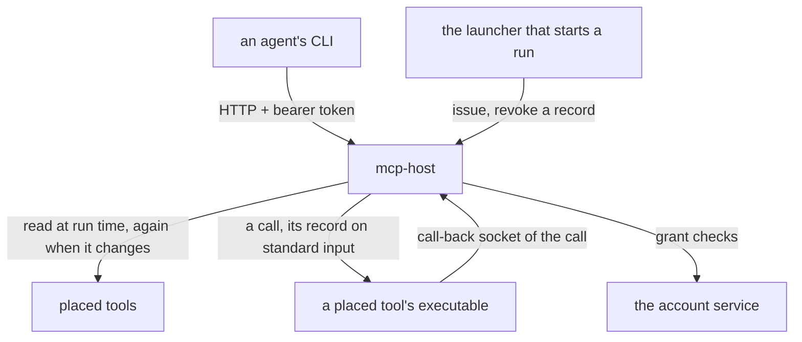

# The tool host

## What it is

- **One process serves every session's MCP tools:** `mcp-host`, under its own user unit.
- **No session starts a tool server of its own.** A session's MCP configuration names the host's address and a
  bearer token, and every call the session makes reaches the one host.
- **The host tells sessions apart by the token alone.** Each token is bound to a session record, which carries
  everything a tool reads of the run it serves: its checkout, its data root, its place, its own values and which
  entries it is shown by name (「The session record」).
- **Every tool is placed:** a folder holding a built tool and its manifest, in any language, which the host reads
  at run time and whose own executable it runs for each call (「Placed tools」). No tool is linked into the host,
  and no list of tools, namespaces, capabilities, lines or roles stands in its code.
- **Where a tool comes from is not the host's concern.** A standalone tool is a repository of its own; a tool
  bound to one service stands in that service's `tools/` folder. Both are placed the same way and both are
  registered the same way (`docs/registry.md`), and the host reads every placed manifest alike.

## Namespaces and capabilities

- **A namespace is whatever a manifest declares:** each entry names the namespace it is shown under, and a
  session's configuration lists one server per namespace its line uses, and the toolbook beside them. So a tool
  keeps the name the CLI calls it by (`mcp__<namespace>__<name>`), whichever executable answers it.
- **The host serves `/mcp/<namespace>` for every namespace a placed manifest names,** and holds no list of
  namespaces; a path naming none is answered 404. A manifest may name a namespace no line's configuration names
  yet, and its entries are reached through the toolbook until a line's configuration names that namespace.
- **A capability is a name a manifest declares and the issuer grants,** written `<subject>.<word>`: an entry
  declares the capabilities a session must hold to be shown it, and the record's issuer grants them by the same
  name. The host compares names and knows none of them.
- **A tool never names a line or a role,** and the host never reads what a line or a role is: a record arrives
  with the capabilities and the shown entries already resolved by its issuer, so a new line or a new tool changes
  only its own declaration.
- **An entry for the system alone** is never shown to a session or callable by one; another tool reaches it
  through its call-back socket, and the system through the control socket (「The catalogue on the control
  socket」).
- **Capabilities are held by name** against the record's; a name no issuer grants is one no session holds, so its
  entry is shown to none.
- **What a session holds** is every entry it holds whole — its record holds the entry's every capability — and,
  where it does not, the narrower form a bundle shows the entry in, where its record holds that bundle's
  capability. A bundle's form shows the arguments the entry names for it alone, refuses any other, and acts under
  no grant. A call to an entry the session does not hold is refused as an unknown tool, and a call is held to the
  form the session holds.
- **A namespace lists the resident entries it holds; the toolbook lists the booked ones.** An entry is resident
  where the record's `shown` list names it by full name (`docs/toolbook.md`, 「Which tools are resident」), and the
  toolbook, served at `/mcp/toolbook` beside the namespaces, lists, describes and calls the rest by the same
  dispatch a direct call takes.

## The session record

- **Issued by the launcher before the program starts,** over the host's control socket, which only the host's own
  user can reach. The launcher posts the record to `/sessions` and the host answers a fresh token; a record it
  cannot read, or one naming a field it does not know, is refused with why. `DELETE /sessions/<token>` revokes
  one. The record's fields are stated in `docs/api.md` (「The session record」).
- **What it holds:**
  - the line it is issued for, and the role of the agent it is issued for where it holds one, both carried as
    names a tool may read and never interpreted by the host;
  - its capabilities, as the issuer resolved them for the line and the agent's role, narrowed where a run holds
    less;
  - `shown`: the full names of the entries its namespaces list by name, as the issuer resolved them for the
    line and the role together; a record without it is shown none by name, and every entry it holds stands in its
    toolbook;
  - the checkout the run works in;
  - the data root the run reads, and the archive address it hands its tools where it names one;
  - the agent's place, for a resident program, where each call reads which run is going;
  - the run's own variables — the run name, the job runner's marker, the work-order step and every `BMO_TURN_`
    variable — for a run spawned for itself;
  - the fragment desk an editor's batch opened, where it opened one;
  - a research run's close, owner, source, role, branch allowance, room, fetch strategy, pacing intervals and
    rulebooks, where the run is a search, a browse or a branch;
  - a deadline, for a run's record.
- **Where it is kept:** one file per record in `tool-host/sessions/` under the data root, readable by the host's
  user alone, named by the SHA-256 of the token rather than the token. The host reads them at start, so a restart
  of the host costs no session its tools.
- **How it ends:**
  - a run's record carries the run's own deadline; the issuer revokes it when the run ends, and the host drops one
    whose deadline has passed at its next sweep, so an issuer that died leaves nothing standing;
  - a resident program's record carries no deadline and stands until the issuer replaces or ends that program,
    which revokes it;
  - what a record's tools keep for it ends with it (「What a record's tools keep」).
- **What a call reads per call** — the run its place names among it — is read afresh on every call. Nothing of one
  record is ever visible to a call made with another token.

## Transport

- **Streamable HTTP, stateless.** The host keeps no MCP session id: every request stands alone and is known by its
  bearer token. A host restarted between two calls is never noticed by the CLI, since there is no protocol session
  for it to lose.
- **A configuration names each server by its URL and an `Authorization` header of `Bearer ${BMO_MCP_TOKEN}`,**
  which a CLI expands from its own environment, so no token is written into a configuration file. A client that
  takes the bearer token from a named variable is handed `BMO_MCP_TOKEN` as that variable.
- **A call takes as long as its tool does.** A client is told to wait on a call as long as it can be told to,
  since an unbounded entry waits for what it set off; how each CLI is told so is its launcher's.
- **The protocol revision a client negotiates may refuse a result that does not say enough:**
  - every result the host builds says it is complete (`resultType`);
  - a listing or a resource read also says how long it may be kept and by whom: never past its answer, and by the
    asking session alone, since a placement can change it at any call and what a session is shown is its
    record's;
  - a client on an earlier revision is answered without the completion mark.
- **The host listens on the loopback address only,** on the port `--port` or `BMO_MCP_HOST_PORT` names, and on
  3290 where neither does; 0 takes any free port.

## When the host is not there

- **A launcher asks the host for the token before it starts a program,** and refuses the launch where the control
  socket does not answer, so no program is started without its tools. A configuration naming a server that does
  not answer costs a CLI session its tools in silence; the token request is the refusal the CLI never gives
  itself.
- **A placed tool that fails a read or a call** fails that one alone, named in its answer: the next starts its
  executable afresh.

## Placed tools

### The catalogue

- **Read from every placed folder the host is given:** the folders under the tools root `--tools` names — each
  tool folder's `.placed/` — and the placed version of every tool the registry holds (`docs/registry.md`). A folder
  under the tools root whose name starts with `_` is no tool. A registered manifest with a `[helper]` table is a
  shared helper (「Shared helpers」); one under the tools root is left out, since helpers are found through the
  registry alone.
- **Only a placed folder is read.** It is what a deployment or `bmo-pocket put` places; the source a placement is
  built from is never read by the host.
- **Read again when it changes:** the host watches the tools root and the registry with the `notify` crate, and
  once no change has come for the settle time — 300 ms, or what `--settle-ms` names — it reads the whole catalogue
  again and puts it in place at once. Every listing, `list`, `describe` and call answers from the catalogue as it
  then stands, so a tool placed, replaced or taken away is seen with no restart of the host or of a session.
- **A flip is a change like any other:** a watched folder is named as given, never resolved once for all, and the
  directory each link on its path stands in is watched as well. Once the changes settle, where the folder's real
  path now lies elsewhere — a deploy tree's link flipped onto a new release — the host watches the new folder in
  place of the old and reads it.
- **A call keeps the tool it started with.** A call holds the placed tool it was dispatched to until it answers,
  and a placed folder that has left the catalogue is taken away only once no call holds it, so a tool replaced or
  taken away mid-call never breaks the call (`docs/registry.md`, 「Versions」).
- **A manifest that does not read leaves its tool out,** said in the host's log with why, and every other tool goes
  on being served. It does not read where:
  - it is not a manifest, or names a field the manifest does not have;
  - it speaks a protocol version the host does not, or names no timeout;
  - its name is not its folder's, or it has neither an entry nor resources, or a helper's has entries;
  - an entry has no description, or asks for no capability without being for the system alone;
  - an entry's schema file is missing, or is not a JSON Schema;
  - an entry's full name is one another tool already holds; of two tools, the one read first keeps it, the tools
    root's in name order before the registry's in name order;
  - a registered tool's version folder is gone.
- **Each reading is said in the log,** with how many tools and helpers it placed.

### The manifest

- **`tool.toml`, read by the tool contract crate `bmo-tool`** (`sdk/contract/`), which the host and `bmo-pocket`
  both link. Its schema is stated in full in `docs/api.md` (「The manifest」).

### A call

- **A call:** one process per call, in a process group of its own, started in the placed folder and handed one
  JSON object on standard input — the protocol version, the kind `call`, the entry's full name, its arguments, the
  session record, the path of the call's call-back socket and the socket of each shared helper the tool names. It
  answers one JSON object on standard output, the protocol's tool result, and ends; what it writes on standard
  error goes to the host's log.
  - An exit that is not clean, or an answer that does not read as a tool result, is a failed call, named with its
    exit and the last lines it wrote on standard error.
  - A call past its timeout — the entry's, or the tool's — has its process group ended, and is said to have failed.
    An unbounded entry's call has none: it ends when it answers or its caller goes away.
  - A call whose caller goes away before it answers — a control request or a session's request closed, the process
    that asked it stopped — has its process group ended as well, so a caller's cap or stop reaches every process
    the call started.
- **A server:** a process speaking MCP over standard input and output, started at a record's first call of the tool
  and handed, in its `BMO_TOOL_START` variable, the same object less the call — the protocol version, the record,
  its call-back socket and its helpers' sockets. Each call is a `tools/call` of the entry's name; the server ends
  with the record. A call past its timeout fails and ends the server, and the record's next call starts it again.
- **A clean environment:** the host's `PATH`, `HOME` and `XDG_RUNTIME_DIR`, each variable `--pass-env` names from
  the host's own environment, the record's data root as `BMO_DATA_DIR` and its archive address as
  `BMO_ARCHIVE_URL` where it names one, and its turn — the run's own variables, or those of the run its place
  names. No other variable of the host's reaches it, and the token never leaves the host.
- **The call-back socket is the call's alone,** bound under `calls/` beside the control socket and taken away as
  the call ends; a server's stands as long as the server. One JSON object is asked on one line and one answered:
  - `call`: an entry by its full name, with its arguments, dispatched under the same record through the same
    schema, capability and grant checks as a session's call, so a tool reaches another only as far as the session
    it serves could; an entry for the system alone is reached this way too;
  - `claim`: an address, answered with the entry that claims it among those the record holds and the arguments it
    reads that page with, or with none: each entry whose manifest claims the address's host is asked in turn.
- **A claim request** is a call of kind `claim` handed the address, which the entry's executable answers with the
  arguments it reads the page with, or with none. No shared helper is started for it: a claim reads the address
  alone.
- **Resources:** a tool whose manifest declares them is asked, by the kinds `resources_list` and `resources_read`,
  for the sessions holding what they ask; its namespace lists every such tool's, and a read is answered by the
  first tool that holds the address. Where none does, the read is refused with the reason the last tool asked
  gave, or as not found where none gave one.
- **An entry is booked unless its record's `shown` names it:** the toolbook lists, describes and calls it
  (`docs/toolbook.md`), and a direct call by its own name is answered as a booked tool's is.

### Shared helpers

- **A shared helper is a process a record's calls share,** placed and registered like a tool, with a `[helper]`
  table in place of entries. A tool names the helpers its calls use, by name.
- **Started at the record's first call of a tool naming it:** its run command in its placed folder, in the clean
  environment of a call, handed on standard input the protocol version, the kind `helper`, the record and the
  socket it is to listen on. The host waits, within the helper's timeout, for its first line on standard output,
  which says it listens there, and hands that socket to every call of the record naming the helper; what it writes
  after goes to the host's log.
- **Ended with the record:** asked to end by `SIGTERM`, given ten seconds to close what it holds, then its process
  group ended and its socket taken away. It ends so at the record's revocation, its lapse, or the host stopping,
  and a helper ends with the host by the parent-death signal where the host itself is gone.
- **A helper placed anew serves the records started after it;** a record's helper already running goes on as it
  is.

### The catalogue on the control socket

- **`GET /catalogue`, `GET /catalogue/<namespace>/<name>`, `POST /calls` and `POST /claims`** read and call the
  catalogue as the system does, entries for the system alone included (`docs/api.md`, 「The control socket」). A
  call through `/calls` is made under the record it carries, as a session's call is, and what that record's tools
  kept ends as the call answers.

## What a namespace says of itself

- **Beside its tools, a namespace may say three things,** each declared in its entries' manifests and handed on by
  the control socket:
  - **a listing,** `GET /listings/<namespace>` — the lines a launcher writes into a line's instructions about what
    the namespace serves, one line per entry that declares one, in its order;
  - **its facts,** `GET /facts/<namespace>`, as JSON — what the lines that read it need beyond the tools: the verb a
    sending entry needs, the record a recording entry leaves, the icon each declares, and each list its entries add
    an item to;
  - **its resources,** listed and read on the namespace's own path for the sessions holding what they ask.
- **Each entry adds to them from its manifest:** its listing line, in its order; its verb, record and icon to the
  facts' verbs, records and icons; each item of its `lists`, headed with the entry's name, to the list it names;
  its tool's resources (「Placed tools」).
  - The host names no list: which lists a namespace's facts carry is its entries', and a list is started by the
    first entry naming it.
- **The host adds the digest of what the namespace shows** to its facts: the SHA-256 of every entry it holds,
  ordered by name, each with its name, description, input and output schemas and its read-only, destructive and
  open-world hints. So an entry added or a schema changed moves it, and a line whose prefix carries it opens its
  next session afresh.
- **A namespace that says none of one is answered 404** for it, and lists no resources; one holding any entry
  always has facts, its digest among them.

## What a record's tools keep

- **What a record's calls share is kept by the shared helpers,** one process of each per record, started at the
  first call of a tool naming it and held beside the record in the host's process (「Shared helpers」); nothing
  kept is ever written down.
- **A placed tool's server and a shared helper are kept the same way,** one of each per record.
- **What a record keeps is ended with the record** — a server, a shared helper and whatever each holds — at the
  first of:
  - the record being revoked;
  - the record's deadline passing, which the host's sweep looks for, dropping the record;
  - the host stopping, every process it started ending with it by the parent-death signal.

## The grant lock

- **Beneath the agent's own judgement, the host refuses what the asker may not have done.** The account service
  decides; the host asks it and refuses with the missing grant named.
- **It stands only where all three hold:** an account service is configured (`--accounts`), the switch
  `--grant-lock` does not read `off`, and the account service answers that its account model is in force
  (`GET /accounts/model`). With no account service configured, nothing is checked.
- **A tool that acts declares the room relation it needs** in its entry's `grant`; a tool that reads or only speaks
  declares none, and a bundle's form of a tool acts under none.
- **Such a call names the message it acts on** in its `message` argument. The host finds the running turn's room
  in the turn's `BMO_TURN_CHAT` — the run its place names, or the run's own variables — asks the account service
  whether that message's sender holds the relation there, and refuses with the missing grant named
  (`bmo_room:<room>#<relation>`).
  - A turn whose every new message is the owner's, or that no person's message opened, acts for nobody else; a call
    there may name no message, which the turn's `BMO_TURN_PRIVILEGED` says.
  - A call naming no message elsewhere, made outside any room's turn, or met by an account service that does not
    answer, is refused saying which.
- **A job run for another user's item** carries the user in `BMO_TURN_USER`, and every tool it calls, reading or
  acting, runs only where that user holds `use` on each of the tool's capabilities (`bmo_tools:<capability>#use`).
- **The arguments go on unchanged;** a tool reads `message` as its own where it has a use for it.
- **The calls it makes** are stated in `docs/api.md` (「What the host calls」).

## Tests

- **Session isolation:** two records naming two checkouts each reach their own through the one host, and a token
  never reads another record's checkout, desk or place.
- **Deployment reach:** a placed tool replaced by a build answering differently while a token is in use answers
  the token's next call with the new code.
- **Bundles and facts:** a record holding bundles alone is shown their entries narrowed and refused any argument
  the bundle does not show; a namespace says its digest, verbs, records and icons; a placed tool's resources are
  listed and read for a record holding their capability alone, and a read it refuses says why.
- **Capability:** a session lacking a tool's capability is not shown it and is refused when it calls it.
- **Toolbook:** a namespace lists the entries the record's `shown` names alone; the toolbook lists and describes
  the booked ones, calls a read-only one with `call` and refuses with `act` named one that acts, refuses arguments
  that do not fit the tool's schema with the schema, refuses a tool the session does not hold by the words a direct
  call is refused with, and answers a booked tool called by its own name.
- **Grant lock:** an acting tool naming no message, or one whose sender holds no grant, is refused with the grant
  named; a reading tool passes; a turn of the owner's alone names none; a job run for another user is refused a
  tool whose capability they hold no `use` on; the switch turns it off, and with no account service configured or
  the model not in force nothing is checked.
- **Placed tools:** a tool placed while the host runs is listed by the toolbook, described, and called through
  `call` and `act` under the schema, capability and grant checks; its call-back socket reaches another entry only
  as the session could; a call past its timeout fails; taken away, it is gone from the list and refused as unknown,
  the host's process the same one throughout. A shared helper, registered, serves one record's calls and no
  other's and ends with the record; a server tool is spoken to over MCP and keeps one process across a record's
  calls. A manifest that does not read is said in the log and leaves the rest served.
- **The registry:** a tool put from a folder, a git address or a bare name through the source template is placed
  as a version, pointed at and served from the next reading; each refusal names what failed and places nothing; a
  put and a service's registration never replace each other; an upgrade moves the pointer and a take removes it; a
  call in flight goes on in the version it started in through an upgrade and a take, which is taken away once
  nothing holds it; and a running session's `initialize` and `tools/list` answers stay byte for byte while its
  toolbook's `list` changes (`docs/registry.md`).
- **The control socket:** an entry for the system alone is shown to no session and called through `/calls`;
  `/claims` names the entry whose manifest claims an address's host and whose executable claims the address, and
  none for one no entry claims.
- **The CLI's header:** an installed Claude Code CLI, named by `BMO_LIVE_CLAUDE`, connects to the host with the
  header read from `BMO_MCP_TOKEN` and fails with a wrong one; the suite names none and skips it.
