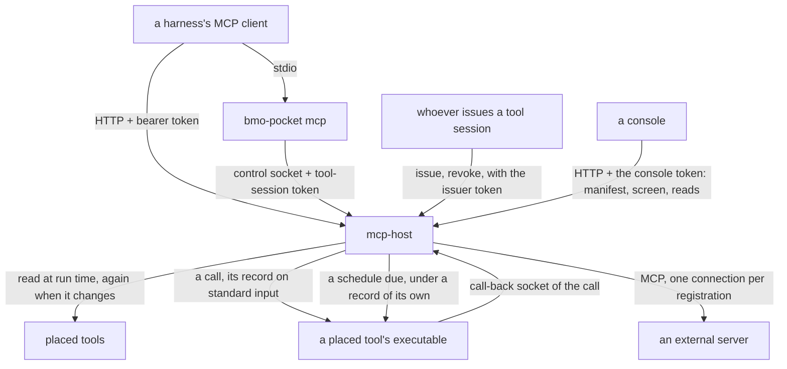

# The tool host

## What it is

- **One process serves every session's MCP tools:** `mcp-host`, under its own user unit.
- **No session starts a tool server of its own.** A harness reaches the one host, either by an MCP configuration
  naming the host's address and a bearer token, or through the harness plugin, `bmo-pocket mcp`, started with the
  token (「The harness plugin」).
- **The host tells sessions apart by the token alone.** Each token is bound to a tool session's record, in which the
  issuer states everything a call is checked against and everything a tool reads of it: the namespaces, the
  capabilities and the grants it holds, which entries it is shown by name, and the variables and labels its tools
  are handed (「The session record」).
- **The host asks no other unit.** What a session may do is what its record carries, so no call waits on an
  account or permission service.
- **Every tool is placed or registered as an external server:** a folder holding a built tool and its manifest,
  in any language, which the host reads at run time and whose own executable it runs for each call (「Placed
  tools」), or an MCP server a registration names, which the host connects to and whose tools it lists and
  forwards calls to (「External servers」). No tool is linked into the host, and no list of tools, namespaces,
  capabilities, grants or holders stands in its code.
- **Where a tool comes from is not the host's concern.** A standalone tool is a repository of its own; a tool
  bound to one service stands in that service's `tools/` folder. Both are placed the same way and both are
  registered the same way (`docs/registry.md`), and the host reads every placed manifest alike.

## Namespaces and capabilities

- **A namespace is whatever a manifest declares:** each entry names the namespace it is shown under, and a record
  names the namespaces its session may use. A harness's configuration lists one server per namespace its record
  names, and the toolbook beside them, so a tool keeps the name its harness calls it by (`mcp__<namespace>__<name>`
  in some), whichever executable answers it.
- **The host serves `/mcp/<namespace>` for every namespace a placed manifest names,** and holds no list of
  namespaces; a path naming none, or one the session's record does not name, is answered 404. A manifest may name a
  namespace no record names yet, and its entries are reached by no session until a record names it.
- **A capability is a name a manifest declares and the issuer grants,** written `<subject>.<word>`: an entry
  declares the capabilities a session must hold to be shown it, and the record's issuer grants them by the same
  name. The host compares names and knows none of them.
- **A tool never names a holder,** and the host never reads what a holder is: a record arrives with its namespaces,
  capabilities, grants and shown entries already resolved by its issuer, so a new holder or a new tool changes only
  its own declaration.
- **An entry for the system alone** is never shown to a session; another tool reaches it through its call-back
  socket, and the system through `POST /tool-calls`, under a record naming its namespace (「The control socket」).
- **Capabilities are held by name** against the record's; a name no issuer grants is one no session holds, so its
  entry is shown to none.
- **What a session holds** is every entry of its namespaces it holds whole — its record holds the entry's every
  capability — and, where it does not, the narrower form a bundle shows the entry in, where its record holds that
  bundle's capability. A bundle's form shows the arguments the entry names for it alone, refuses any other, and acts
  under no grant. A call to an entry the session does not hold is refused as an unknown tool, and a call is held to
  the form the session holds.
- **A namespace lists the resident entries it holds; the toolbook lists the booked ones.** An entry is resident
  where the record's `shown` list names it by full name (`docs/toolbook.md`, 「Which tools are resident」), and the
  toolbook, served at `/mcp/toolbook` beside the namespaces, lists, describes and calls the rest by the same
  dispatch a direct call takes.

## The session record

- **Issued before the session starts,** over the host's control socket with the issuer token (「Tokens」). The
  issuer posts the record to `POST /tool-sessions` and the host answers the tool session with a fresh token; a record
  it cannot read, or one naming a field it does not know, is refused with why. `DELETE /tool-sessions/<token>`
  revokes one. The record's fields are stated in `docs/api.md` (「The session record」).
- **What it holds:**
  - `holderName`, who holds the session, a name a tool may read and the host never interprets;
  - `namespaces`, the namespaces the session may use;
  - `capabilities`, as the issuer resolved them for the holder;
  - `grants`, the resources the session may act on (「Grants」);
  - `shown`: the full names of the entries its namespaces list by name; a record without it is shown none by name,
    and every entry it holds stands in its toolbook;
  - `variables`, handed to every call's environment, and `variablesFile`, a file read afresh at every call and
    laid over them, so an issuer whose values move while the session stands rewrites the file rather than the
    record;
  - `labels`, the issuer's own metadata, handed to every call inside the record;
  - `expiresAt`, from the `ttlMs` the issuer asked for, and `createdAt`.
- **Where it is kept:** one file per record in `tool-host/sessions/` under the data root, readable by the host's
  user alone, named by the SHA-256 of the token rather than the token. The host reads them at start, so a restart
  of the host costs no session its tools.
- **How it ends:**
  - a record with an `expiresAt` lapses then: the host refuses its token from that moment and drops it at its next
    sweep, so an issuer that died leaves nothing standing;
  - a record with none stands until the issuer revokes it;
  - what a record's tools keep for it ends with it (「What a record's tools keep」).
- **What a call reads per call** — the record's `variablesFile` among it — is read afresh on every call. Nothing of
  one record is ever visible to a call made with another token.

## Tokens

- **The control socket takes a bearer token on every route,** of one of two kinds (`docs/api.md`, 「The control
  socket」).
- **The issuer token** is the host's own: a random token in `tool-host/issuer-token` under the data root, or in the
  file `--issuer-token-file` names, readable by the host's user alone. The host makes it at its first start where
  none stands and reads it at every start. Whoever issues tool sessions reads it from that file, so reaching the
  file is what makes an issuer. It alone issues and revokes tool sessions, and it reads the whole catalogue and
  every schedule.
- **A tool session's token** reaches what its record holds and nothing else: its namespaces, the entries its
  capabilities open there, calls and claims under its grants, and the schedules of those entries. The tools face
  takes this kind alone.
- **No session can widen itself.** A session's token can issue nothing, so the only records standing are those the
  issuer wrote.
- **The console token** reaches the console face alone (`docs/api.md`, 「The console face」): a random token in
  `tool-host/console-token` under the data root, or in the file `--console-token-file` names, readable by the
  host's user alone and made at the first start that opens the face. It reads what the issuer token reads and
  writes nothing, so a console holding it can show the host but never issue a session or call a tool.

## Transport

- **Streamable HTTP, stateless.** The host keeps no MCP session id: every request stands alone and is known by its
  bearer token. A host restarted between two calls is never noticed by the harness, since there is no protocol
  session for it to lose.
- **A configuration names each server by its URL and an `Authorization` header of `Bearer ${BMO_MCP_TOKEN}`,**
  which a harness expands from its own environment, so no token is written into a configuration file. A client that
  takes the bearer token from a named variable is handed `BMO_MCP_TOKEN` as that variable.
- **A call takes as long as its tool does.** The host keeps no clock on a call, so a client is told to wait on a
  call as long as it can be told to; how each harness is told so is its issuer's.
- **The protocol revision a client negotiates may refuse a result that does not say enough:**
  - every result the host builds says it is complete (`resultType`);
  - a listing or a resource read also says how long it may be kept and by whom: never past its answer, and by the
    asking session alone, since a placement can change it at any call and what a session is shown is its
    record's;
  - a client on an earlier revision is answered without the completion mark.
- **The host listens on the loopback address only,** on the port `--port` or `BMO_MCP_HOST_PORT` names, and on
  3290 where neither does; 0 takes any free port.

## When the host is not there

- **An issuer asks the host for the token before it starts a session,** and refuses to start it where the control
  socket does not answer, so no session is started without its tools. A configuration naming a server that does
  not answer costs a harness its tools in silence; the token request is the refusal the harness never gives itself.
- **A placed tool that fails a read or a call** fails that one alone, named in its answer: the next starts its
  executable afresh.

## Placed tools

### The catalogue

- **Read from every placed folder the host is given:** the folders under the tools root `--tools` names — each
  tool folder's `.placed/` — and the placed version of every tool the registry holds (`docs/registry.md`); and
  from the tools every external server the registry holds last listed (「External servers」). A folder
  under the tools root whose name starts with `_` is no tool. A registered manifest with a `[helper]` table is a
  shared helper (「Shared helpers」); one under the tools root is left out, since helpers are found through the
  registry alone.
- **Only a placed folder is read.** It is what a deployment or `bmo-pocket put` places; the source a placement is
  built from is never read by the host.
- **Read again when it changes:** the host watches the tools root and the registry with the `notify` crate, and
  once no change has come for the settle time — 300 ms, or what `--settle-ms` names — it reads the whole catalogue
  again and puts it in place at once. Every listing, `list`, `describe` and call answers from the catalogue as it
  then stands, so a tool placed, replaced or taken away is seen with no restart of the host or of a session.
- **A flip is a change like any other:** a watched folder is named as given, never resolved once for all, and the
  directory each link on its path stands in is watched as well. Once the changes settle, where the folder's real
  path now lies elsewhere — a deploy tree's link flipped onto a new release — the host watches the new folder in
  place of the old and reads it.
- **A call keeps the tool it started with.** A call holds the placed tool it was dispatched to until it answers,
  and a placed folder that has left the catalogue is taken away only once no call holds it, so a tool replaced or
  taken away mid-call never breaks the call (`docs/registry.md`, 「Versions」).
- **A manifest that does not read leaves its tool out,** said in the host's log with why, and every other tool goes
  on being served. It does not read where:
  - it is not a manifest, or names a field the manifest does not have;
  - it speaks a protocol version the host does not;
  - its name is not its folder's, or it has neither an entry nor resources, or a helper's has entries;
  - an entry has no description, or asks for no capability without being for the system alone;
  - an entry's schema file is missing, or is not a JSON Schema;
  - an entry's manual is named by a path leaving the tool's folder, resolves outside it through a link, or does
    not stand there;
  - an entry's full name is one another tool already holds; of two tools, the one read first keeps it, the tools
    root's in name order before the registry's in name order;
  - a registered tool's version folder is gone;
  - an external server's registration does not read, or its tools are not yet listed.
- **Each reading is said in the log,** with how many tools and helpers it placed.
- **Each reading tells what it changed on the event stream** (`docs/api.md`, 「Events」): a tool it serves that the
  last reading did not, or in another placed version, as `tool.placed` with the entries a session can be shown;
  a tool whose pointer or folder is gone as `tool.removed`. The first reading of a run tells nothing, and a tool
  that only fails to read, or whose server's listing is lost, stays told as it was, since its pointer stands. The
  host names no reader of the stream: whoever reads it turns it into what its own readers are told.

### The manifest

- **`tool.toml`, read by the tool contract crate `bmo-tool`** (`sdk/contract/`), which the host and `bmo-pocket`
  both link. Its schema is stated in full in `docs/api.md` (「The manifest」).

### A call

- **A call:** one process per call, in a process group of its own, started in the placed folder and handed one
  JSON object on standard input — the protocol version, the kind `call`, the entry's full name, its arguments, the
  session record, the path of the call's call-back socket and the socket of each shared helper the tool names. It
  answers one JSON object on standard output, the protocol's tool result, and ends; what it writes on standard
  error goes to the host's log.
  - An exit that is not clean, or an answer that does not read as a tool result, is a failed call, named with its
    exit and the last lines it wrote on standard error.
  - A call waits for its process to answer and end, however long that takes: the host keeps no clock on it, and a
    `timeout` or `unbounded` a manifest still carries is read and given no effect.
  - A call whose caller goes away before it answers — a control request or a session's request closed, the process
    that asked it stopped — has its process group ended as well, so a caller's cap or stop reaches every process
    the call started.
- **A server:** a process speaking MCP over standard input and output, started at a record's first call of the tool
  and handed, in its `BMO_TOOL_START` variable, the same object less the call — the protocol version, the record,
  its call-back socket and its helpers' sockets. Each call is a `tools/call` of the entry's name; the server ends
  with the record. Its start and each call wait for the server's answer; a call that fails ends the server, and the
  record's next call starts it again.
- **A clean environment,** each layer laid over the one before it: the host's `PATH`, `HOME` and `XDG_RUNTIME_DIR`
  and each variable `--pass-env` names from the host's own environment; the record's `variables`; the object its
  `variablesFile` holds, where the file stands and reads as an object of strings, a file that does not being said
  in the host's log and adding nothing; and the host's own `BMO_TOOL_START` or `BMO_SCHEDULED_AT` where the call has
  one. No other variable of the host's reaches it, and the token is never handed to a tool.
- **The call-back socket is the call's alone,** bound under `calls/` beside the control socket and taken away as
  the call ends; a server's stands as long as the server. One JSON object is asked on one line and one answered:
  - `call`: an entry by its full name, with its arguments, dispatched under the same record through the same
    schema, capability and grant checks as a session's call, so a tool reaches another only as far as the session
    it serves could; an entry for the system alone is reached this way too;
  - `claim`: an address, answered with the entry that claims it among those the record holds and the arguments it
    reads that page with, or with none: each entry whose manifest claims the address's host is asked, one after
    another.
- **A claim request** is a call of kind `claim` handed the address, which the entry's executable answers with the
  arguments it reads the page with, or with none. No shared helper is started for it: a claim reads the address
  alone.
- **Resources:** a tool whose manifest declares them is asked, by the kinds `resources_list` and `resources_read`,
  for the sessions holding what they ask; its namespace lists every such tool's, and a read is answered by the
  first tool that holds the address. Where none does, the read is refused with the reason the last tool asked
  gave, or as not found where none gave one.
- **An entry is booked unless its record's `shown` names it:** the toolbook lists, describes and calls it
  (`docs/toolbook.md`), and a direct call by its own name is answered as a booked tool's is.

### Shared helpers

- **A shared helper is a process a record's calls share,** placed and registered like a tool, with a `[helper]`
  table in place of entries. A tool names the helpers its calls use, by name.
- **Started at the record's first call of a tool naming it:** its run command in its placed folder, in the clean
  environment of a call, handed on standard input the protocol version, the kind `helper`, the record and the
  socket it is to listen on. The host waits for its first line on standard output, or for it to end without one,
  which says it listens there, and hands that socket to every call of the record naming the helper; what it writes
  after goes to the host's log.
- **Ended with the record:** asked to end by `SIGTERM` and waited on until it has closed what it holds and ended,
  then whatever it left standing in its process group ended and its socket taken away. It ends so at the record's revocation, its lapse, or the host stopping,
  and a helper ends with the host by the parent-death signal where the host itself is gone.
- **A helper placed anew serves the records started after it;** a record's helper already running goes on as it
  is.

### External servers

- **An external server is an MCP server registered by configuration** (`docs/api.md`, 「The registration of an
  external server」): a command the host starts and speaks to on standard input and output, or a streamable HTTP
  address with its headers and token file; the namespace its tools are listed under, the capabilities a record
  must hold to be shown them, which of `call` and `act` reaches a tool its annotations do not mark, and a
  manual for any of its tools. Nothing is built for it: `bmo-pocket put --mcp` places the registration and
  the manuals it names (`docs/registry.md`).
- **Its tools are entries like any placed tool's.** The host reads each listed tool as an entry under the
  registration's namespace and capabilities (`docs/api.md`, 「How a listed tool reads as an entry」), so the
  namespaces and the toolbook list, describe and call them through the same dispatch, under the same schema,
  capability and residency rules, and `reachedBy` follows the read-only hint as it does for any entry.
- **One connection per registration, shared by every record.** The host connects when it reads a registration
  with no connection standing, asks `tools/list` for every page, and keeps the connection for the calls of every
  record. So no record's variables, labels, call-back socket or shared helpers reach the server, and it holds
  nothing of one record for that record alone.
  - A stdio server is started in the registration's placed folder, in its own process group, with a clean
    environment: the host's `PATH`, `HOME` and `XDG_RUNTIME_DIR`, and the registration's `env` laid over them. It
    ends with the host by the parent-death signal, and what it writes on standard error goes to the host's log.
  - A streamable HTTP server is sent the registration's headers and, where it names a token file, the file's text
    as its bearer token, read afresh at each connection.
- **Its tools join the catalogue once listed.** A listing that differs from the last one has the catalogue read
  again; a server that says its tool list changed is listed again. A registration with no listing yet stands out
  of the catalogue, said in the log with why, and is tried again at each reading and every 30 seconds while it
  stays unlisted. A listing runs beside the reading of the placed tools and never holds it back, and a server whose
  listing is still under way is not asked again until it answers.
- **A call is a `tools/call` of the tool's own name,** as the server listed it, on the registration's connection,
  waiting for the server's answer however long it takes; its result is answered unchanged. Connecting and listing
  wait for the server the same way. A call that fails on the connection — the server gone or unreachable — ends
  the connection, and the next call or reading connects and
  lists again, so a server that died is started again on demand. An error the server answers in the protocol
  fails that call alone and leaves the connection standing.
- **A registration taken or replaced** leaves the catalogue at the next reading, and its connection ends once no
  call holds it, as a placed version is taken away once nothing holds it.

### The control socket

- **Its routes read and call the catalogue for a token** (`docs/api.md`, 「The control socket」): the issuer token
  sees every namespace, entry and schedule, those for the system alone among them, and a tool session's token what
  its record holds. A call through `POST /tool-calls` is made under the token's record, as a session's call on the
  tools face is, and reaches an entry for the system alone of the record's namespaces too.
- **The control socket answers its refusals by status,** in the common error shape: a call the host refuses or
  that fails before the tool answers is a non-2xx status naming why, where a session's call on the tools face is
  answered the same refusal as a failed tool result for its model to read.
- **It serves the paragraph on finding and using tools** that a session's system prompt carries, as text on
  `GET /discipline` (`docs/toolbook.md`, 「The rules a prompt carries」): the session reaches tools it does not hold
  by name with `bmo use`.
- **Each tool member carries its icon,** and `GET /schedules` where each schedule stands, so a reader needs no
  second route for either.
- **The issuer reads the sessions standing and the external servers:** `GET /tool-sessions` answers each record's
  holder, reach and times, never its token or a variable's value, and `GET /servers` each registration the host
  read with whether its server's tools are listed and why not.
- **A session says which of its servers connected:** each namespace, and the toolbook, whose `initialize` or
  `tools/list` the tools face answered under the session's token, with when it first did, kept in memory since the
  host started and dropped with the record. `GET /tool-sessions/{token}` answers it for one session, so an issuer
  that launched a harness reads which servers of its configuration never connected.
- **The issuer reads the event stream,** `GET /events`, where each reading of the catalogue tells the tools it
  placed and removed (「The catalogue」).

### The console face

- **The host's screen is a console bundle** it serves itself (`docs/api.md`, 「The console face」): a console reads
  its manifest, loads its module and relays the screen's reads on a loopback port of the face's own, opened where
  the deployment names one. The screen shows the catalogue, the schedules, the sessions standing and the external
  servers, read as the issuer reads them.
- **The face reads and writes nothing of its own.** Its routes are the bundle's files and the control socket's reads,
  answered by the same code, so the screen never shows the host other than the control socket does.
- **The host is the guard,** as the contract has a service be: the console token on every route, and
  `Owner-Role: administrator` on every route the screen uses.

#### How the screen reads

- **It stands under the console's title bar where the console offers one** (bmo-web's `docs/web.md`, 「The title
  bar」): its route asks for the console's bar in its meta, and where the console provides the offer the screen draws
  no bar of its own; read where nothing offers it, it draws its own. Under the bar stands the screen's own row: the
  view switch, the search, and at the row's end the button that reads the view again, which stays in the row at a
  phone's width, the search giving up its width first.
- **The catalogue's columns follow the room the screen has,** measured on its own box and never on the window:
  - wide, the namespaces, the namespace's tools and the open tool stand side by side, the tools keeping a width
    a line of their description reads at;
  - narrower, the open tool stands in the place of the tool list, with a way back to it, beside the namespaces;
  - at a phone's width, each of the three stands alone in turn.
- **No value is shown as JSON.** A value stands as what it is: a list as its rows, an object as its named fields,
  a moment as a moment, a yes or a no as a state word.
  - A tool's hints read as state words: whether calling it twice does the same as once — yes, no or not
    known — and whether it reaches outside the host.
  - A tool's input and output schemas stand as their fields, one row each, nested fields under their parent's
    name: its name, its type, whether it is required, what it is for and what it takes (its choices, its range,
    its default). A schema of no fields stands as a highlighted code block.
  - A session's labels stand one row each, the label's name beside its value; a schedule's arguments stand as
    their named fields.

### Schedules

- **A tool declares when its entry is called,** in the entry's `[[entry.schedule]]` tables, each a cron pattern and
  the arguments the call is handed (`docs/api.md`, 「Schedules」). The host names no schedule of its own and knows no
  tool that has one: it reads every placed manifest's schedules as it reads the catalogue.
- **The host keeps every schedule of the catalogue as it stands.** A beat each second — or what `--schedule-every-ms`
  names — reads the catalogue's schedules; a schedule newly seen, or whose pattern or arguments changed, is next due
  at its pattern's first time after that beat, and one whose entry has left the catalogue is dropped.
- **A schedule due is called once,** at the first beat at or past its time, and is then due at its pattern's next
  time after that beat. So a beat that comes late calls it once, never once per time it passed, and a time that
  passed while the host was not running is not made up.
- **One call of a schedule runs at a time:** a time that comes while its last call still runs is passed over.
- **A scheduled call is dispatched as `POST /tool-calls` dispatches one,** through the schema, capability and grant
  checks, under a record of its own made for that call: `holderName` `schedule`, the entry's namespace, its
  capabilities and its grant, and the host's variables `--pass-env` names. What that record's tools kept ends as
  the call answers.
- **What a schedule stands at is kept in the host's process alone:** when it is next due, when its last call was
  made, why that call failed where it did, and whether one runs. `GET /schedules` answers it; a failure is said in
  the host's log as well. A restart begins every schedule afresh.

## What a namespace says of itself

- **Beside its tools, a namespace may say three things,** each declared in its entries' manifests:
  - **a listing:** the line each entry declares about what it serves and its order, carried as each tool member's
    `listing`, which a caller may write into its own instructions in that order;
  - **its facts,** in the namespace member's `facts`, as JSON — what a reader needs beyond the tools: the verb a
    sending entry needs, the record a recording entry leaves, the icon each declares, and each list its entries add
    an item to;
  - **its resources,** listed and read on the namespace's own path for the sessions holding what they ask.
- **Each entry adds to them from its manifest:** its listing line, in its order; its verb, record and icon to the
  facts' verbs, records and icons; each item of its `lists`, headed with the entry's name, to the list it names;
  its tool's resources (「Placed tools」).
  - The host names no list: which lists a namespace's facts carry is its entries', and a list is started by the
    first entry naming it.
- **The host adds the digest of what the namespace shows** to its facts: the SHA-256 of every entry the token sees
  in it, ordered by name, each with its name, description, input and output schemas and its read-only, destructive
  and open-world hints. So an entry added or a schema changed moves it, and a reader whose cached prompt carries it
  starts its next session afresh.
- **A namespace holding any entry the token sees always has facts,** its digest among them.

## What a record's tools keep

- **What a record's calls share is kept by the shared helpers,** one process of each per record, started at the
  first call of a tool naming it and held beside the record in the host's process (「Shared helpers」); nothing
  kept is ever written down.
- **A placed tool's server and a shared helper are kept the same way,** one of each per record.
- **What a record keeps is ended with the record** — a server, a shared helper and whatever each holds — at the
  first of:
  - the record being revoked;
  - the record's `expiresAt` passing, which the host's sweep looks for, dropping the record;
  - the host stopping, every process it started ending with it by the parent-death signal.

## Grants

- **A tool that acts on something a session may or may not touch declares the resource in its entry's `grant`:**
  an opaque string the issuer and the tool agree on, which the host compares and never reads. A tool that only
  reads declares none, and a bundle's form of a tool acts under none.
- **A call of an entry declaring a grant runs only where the record's `grants` hold that resource,** compared whole.
  Otherwise it is refused before anything runs, the missing resource named: 403 `forbidden` on the control socket,
  a failed tool result on the tools face and the call-back socket.
- **A claim is checked the same way:** an entry claiming an address is answered as the claimant only where the
  record's grants hold its grant (`docs/api.md`, 「Claims」).
- **The issuer decides what a session may act on** by the grants it writes into the record; the host refuses what
  the record does not hold and asks nobody else.

## The harness plugin

- **`bmo-pocket mcp` is the host's MCP server for a harness that starts its servers itself,** on standard input
  and output, holding one tool session's token (`docs/api.md`, 「The harness plugin」). It is a client of the
  control socket and nothing more: every tool it serves is one call of one route through `bmo-pocket-client`.
- **It serves `pocket_namespaces`, `pocket_tools`, `pocket_tool` and `pocket_call`,** and beside them every hosted
  tool of the session's namespaces under the name `<namespace>_<name>`, read afresh at each `tools/list`. A tool
  placed or taken away is in or out of its next list.
- **The `bmo-pocket` skill** tells a harness what the plugin is for, how to start it with a token, which tool reads
  what, and how a refusal reads.

## Tests

- **Session isolation:** two records naming two sets of variables each hand their own to their calls through the
  one host, and a token never reads another record's variables, labels or variables file.
- **Deployment reach:** a placed tool replaced by a build answering differently while a token is in use answers
  the token's next call with the new code.
- **Bundles and facts:** a record holding bundles alone is shown their entries narrowed and refused any argument
  the bundle does not show; a namespace says its digest, verbs, records and icons; a placed tool's resources are
  listed and read for a record holding their capability alone, and a read it refuses says why.
- **Capability and namespaces:** a session lacking a tool's capability, or whose record does not name its namespace,
  is not shown it and is refused when it calls it.
- **Toolbook:** a namespace lists the entries the record's `shown` names alone; the toolbook lists and describes
  the booked ones, a manual's text after the description where the manifest names one, calls a read-only one with
  `call` and refuses with `act` named one that acts, refuses arguments that do not fit the tool's schema with the
  schema, refuses a tool the session does not hold by the words a direct call is refused with, and answers a
  booked tool called by its own name.
- **Grants:** a call of an entry declaring a grant runs where the record's grants hold it and is refused naming it
  where they do not, on the tools face, the call-back socket and the control socket alike; an entry declaring none
  runs; a claim whose claimant's grant the record lacks is not granted and says why.
- **Placed tools:** a tool placed while the host runs is listed by the toolbook, described, and called through
  `call` and `act` under the schema, capability and grant checks; its call-back socket reaches another entry only
  as the session could; a call waits for its answer; taken away, it is gone from the list and refused as unknown,
  the host's process the same one throughout. A shared helper, registered, serves one record's calls and no
  other's and ends with the record; a server tool is spoken to over MCP and keeps one process across a record's
  calls. A manifest that does not read is said in the log and leaves the rest served.
- **External servers:** a stand-in stdio MCP server, registered by configuration, has its tools listed by the
  toolbook under the registration's namespace for a record holding its capability and for no other, a camel-cased
  name made an entry's, a manual described, a read-only tool called through `call` and a tool its annotations do
  not mark refused by `call` and called through `act` as the registration's default says; a server that dies is
  started again by the next call; a streamable HTTP registration is sent its token file's text as its bearer
  token; and a registration taken leaves no tool of it listed or callable. Each refusal of `put --mcp` names what
  failed and places nothing.
- **The registry:** a tool put from a folder, a git address or a bare name through the source template is placed
  as a version, pointed at and served from the next reading; each refusal names what failed and places nothing; a
  put and a service's registration never replace each other; an upgrade moves the pointer and a take removes it; a
  call in flight goes on in the version it started in through an upgrade and a take, which is taken away once
  nothing holds it; and a running session's `initialize` and `tools/list` answers stay byte for byte while its
  toolbook's `list` changes (`docs/registry.md`).
- **The control socket:** every route answers as `docs/openapi.json` states it, each refusal by status with its
  code; the issuer token alone issues and revokes, and a session's token is refused there; a session's token sees
  its namespaces and the entries it holds alone, and the issuer token every one; an entry for the system alone is
  shown to no session and called through `POST /tool-calls`; `POST /claims` names the entry whose manifest claims an
  address's host and whose executable claims the address, and none for one no entry claims; the namespaces and
  tools are paged by name, and the schedules by `nextAt` with no run of equal times split. A session's
  `connected` names each namespace and the toolbook once its `initialize` or `tools/list` is answered, and
  `GET /tool-sessions/{token}` answers it for that session alone.
- **The event stream:** a tool put while the host runs is told as one `tool.placed` naming its namespaces and
  entries, an upgrade as one more with `replaced`, and a take as one `tool.removed`; a reader resuming after a
  number is answered what followed it, one with a cursor older than the window is answered 410 `gone`, the page
  form answers the same events, and a session's token or none is refused.
- **The console face:** a request without the console token is refused on every route, the issuer's and a
  session's tokens among them; the manifest and the words are answered to the token with no role, and the module,
  the stylesheet and the reads only with `Owner-Role: administrator`; the manifest names the built files by their
  digests, reads through bmo-ui's own reading of the contract, and is refused where no bundle stands; and every read
  answers what the control socket answers the issuer. `GET /tool-sessions` pages the standing sessions by
  `createdAt` with no token or variable's value in them, and `GET /servers` names each registration, listed or not.
- **Schedules:** a schedule is due at its pattern's first time after it is seen, is called once at a beat past it
  with its arguments under a record of its own, is passed over while its last call runs, begins afresh when its
  pattern changes and is dropped with its entry; its last failure is kept and said.
- **The harness plugin:** `bmo-pocket mcp`, started as a harness starts it with a session's token, lists the four
  fixed tools and the hosted tools of the session's namespaces exactly, leaves a colliding name out, and calls each
  through the control socket.
- **The harness's header:** an installed Claude Code CLI, named by `BMO_LIVE_CLAUDE`, connects to the host with the
  header read from `BMO_MCP_TOKEN` and fails with a wrong one; the suite names none and skips it.
